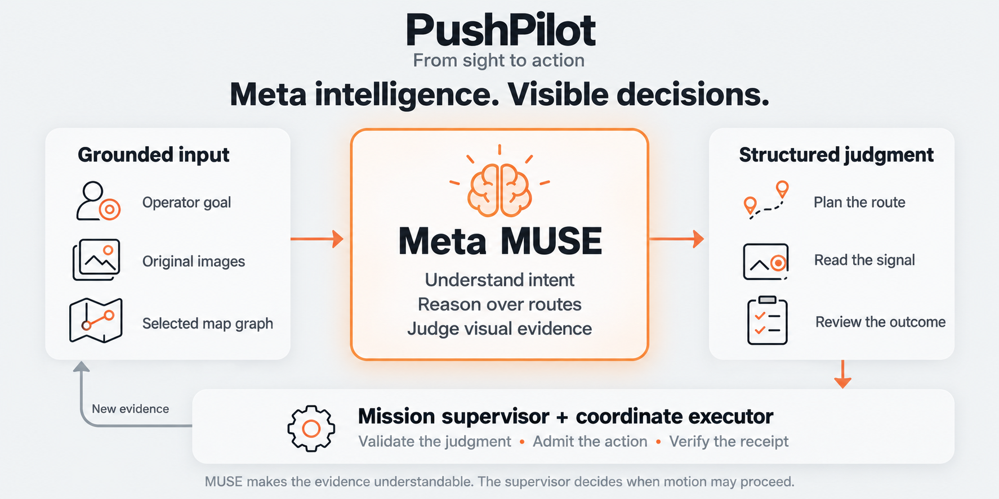
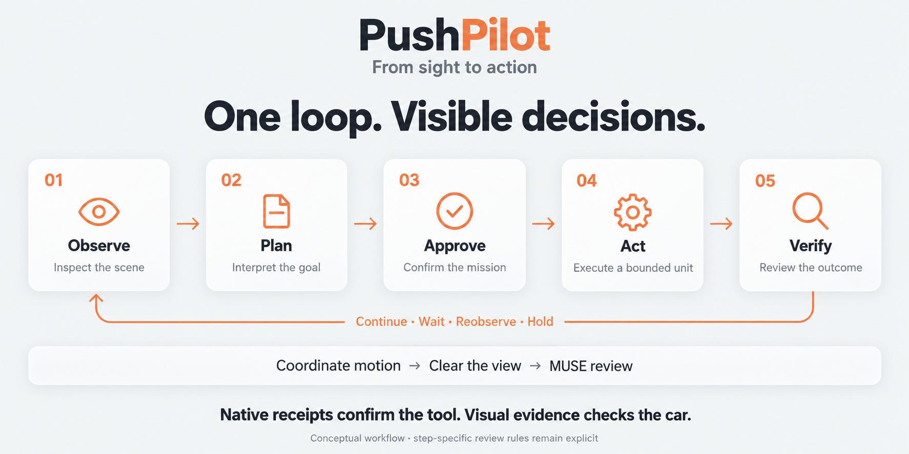

<div align="center">

# PushPilot

### From sight to action.

**A robot can finish a motion without finishing the task.**

See the scene. State the goal. Review the plan. Check the outcome.<br>
Powered by **Meta MUSE**, PushPilot connects operator intent, a spatial plan, coordinate-based motion and visual evidence in one tablet workspace.

[The workspace](#the-workspace) · [The mission](#one-start-three-destinations) · [Architecture](docs/ARCHITECTURE.md) · [Current status](docs/CURRENT_STATUS.md) · [Run it](#quick-start)

<code>Meta MUSE intelligence</code> &nbsp; <code>Image-grounded route planning</code> &nbsp; <code>Visual outcome review</code> &nbsp; <code>Taught BASE motion</code>

</div>

<p align="center">
  <a href="docs/assets/workspace-concept-current.png"></a><br>
  <sub>Original product illustration · the interaction concept, not a camera capture, application screenshot or physical-success result. <a href="docs/assets/README.md">Artwork provenance</a></sub>
</p>

## The workspace

Robot telemetry answers where the tool went. The operator also needs to know whether the car moved, whether the view is readable, and why the system is continuing or waiting. PushPilot keeps these questions beside the scene, with a shared route, clear source labels and a visible next decision.

The original interaction remains the center of the product:

| Observe | Plan | Approve | Act | Verify |
|---|---|---|---|---|
| Inspect the scene and its source. | Interpret the goal and show the selected route. | Confirm the current mission. | Execute a bounded action unit. | Check the receipt and visual outcome before continuing. |

**Camera** preserves the source image's natural perspective. Optional **Board focus** masks the surrounding desk; image, mask and AR route share the same zoom/pan transform. **Spatial** presents the private city model and the same selected drawing route. Its optional car animation is an **execution estimate**, not measured vehicle tracking.

The current interface uses Pretendard, a continuous scene, large rounded glass overlays, charcoal text and restrained orange controls. From/To, route sequence, signal state, visual review and mission history remain close to the scene. Full-page scrolling is disabled; current detailed lists scroll internally, an explicit design requirement to reconcile in the [design system](docs/DESIGN_SYSTEM.md).

The AR-glasses companion remains the original future extension: see a workspace, express an intention and inspect a shared plan. Wearable integration and browser microphone capture remain pending; the finite-upload voice backend is implemented separately.

## One start. Three destinations.

The current City A3 scenario pushes a **wheel-less model car**, starting in the fixed box **in front of Pizza**. It does not pick up or carry the car.

| Destination | Reference | Intended course |
|---|---|---|
| **Office Building** | B | Continue along the southern frontage road. |
| **Villa** | C | Take the common northbound approach, then the west frontage. |
| **Hanok** | D | Take the common northbound approach, then the east frontage. |

The drawing graph supplies place names and AR geometry. The Robot executor uses a separately reviewed **private taught-BASE packet**. A camera overlay, nominal A3 scale or Spatial model does not define robot coordinates or prove an accepted map-to-BASE calibration.

The active site-trial workflow prioritizes delivery. C terminates at **C-step-26**, using a destination/zone review rather than parallel heading; the empty robot then follows its return recipe to common START. Vehicle straightening, learned drift correction and parallel parking remain deferred. Historical B/C/D arrivals are documented, while repeatability of every later derived recipe remains unqualified. [Delivery scope](docs/DELIVERY_SITE_TRIAL.md) · [C26 endpoint](docs/C26_DELIVERY_ENDPOINT.md) · [Measured history](docs/MEASURED_ROUTE_CATALOGUE.md)

At the configured paper-signal approach, the robot completes its contact unit, releases and parks at the selected far-RIGHT observation pose. MUSE judges the two printed colors while one is manually covered: RED waits; unclear or transitioning views wait. After one accepted stopped GREEN admission, the robot recontacts the measured endpoint and proceeds **without a second color wait**. A new mission needs a new admission. [Single signal departure](docs/SINGLE_SIGNAL_DEPARTURE.md)

## What Meta MUSE adds

**Meta MUSE is the intelligence layer: understand the intent, reason over the route and judge the visual outcome.**

<p align="center">
  <a href="docs/assets/muse-intelligence-current.png"></a>
</p>

| MUSE role | Grounded input | What becomes visible |
|---|---|---|
| **Understand and plan** | Operator query, original scene and selected directed graph | Interpreted destination and the chosen route in Camera/Spatial. |
| **Read the signal** | Fresh stopped observations of the selected paper signal | RED/UNKNOWN waiting or one bound GREEN admission. |
| **Review the outcome** | Expected action context and source-bound original images | Visible progress, a clear problem, a new observation or destination arrival judgment. |

The supervisor turns an accepted, current judgment into an execution decision. MUSE does not need to estimate the gripper tip or emit TCP commands; the coordinate executor and Native receipts handle robot motion.

A deliberate planning request sends an original native image, the selected map's directed graph and the operator query to MUSE. Local checks validate the returned node path and its departure, turn, via and avoid constraints. Camera and Spatial consume the same resulting drawing route.

During a physical action unit, approach, contact and withdrawal follow reviewed coordinates. Native receipts verify robot completion. The tool clears the view before original images and expected context reach MUSE for a vehicle outcome review. Expected gripper occlusion during approach is not a demand to visually locate the TCP.

| Evidence | What it contributes |
|---|---|
| **Native/controller receipt** | The bounded robot action reached its verified endpoint. |
| **Original camera images** | Visual evidence of the car and the selected paper signal. |
| **MUSE judgment** | Structured progress, problem, signal or arrival interpretation within the current review policy. |
| **Deterministic supervision** | Session/profile/source identity, freshness, approval, signal admission, holds and no-replay rules. |

The C review policy includes same-source details for C4/C6, a clear pre-recontact reference through C14, qualitative C17 progress, an explicitly configured C19 Native-only omission, and destination-only C26 arrival. A nullable problem field remains unknown in evidence; it is not rewritten to false. [Current C review matrix](docs/C_INTERMEDIATE_PROGRESS_REVIEW.md) · [Explicit continuation](docs/EXPLICIT_REVIEW_CONTINUATION.md)

Recorded-pair and simulation review remain useful independent paths. Earlier Little Town, synthetic-image and provider checks retain their original dates and scope; they are not substituted for current physical evidence. [Provider records](docs/META_API_CHECK.md) · [Evidence index](docs/evidence/README.md)

## Two execution scopes. One understandable loop.

<p align="center">
  <a href="docs/assets/interaction-current.png"></a>
</p>

| Scope | Available behavior | Boundary |
|---|---|---|
| **Default simulation** | Graph planning, simulated action/stop receipts, source-labelled review and replay; runs without equipment or model credentials. | Does not move hardware. Little Town remains the source-default compatibility map; City is selected explicitly. |
| **Configured Robot trial** | Tablet Start/Stop, taught-coordinate B/C/D units, Native receipts, post-withdrawal MUSE review, configured signal wait/recontact and empty return. | Requires private runtime, current site packet, configuration and fresh readiness. Historical demonstrations are not general production qualification. |
| **Presentation** | Camera/Spatial route, actual physical sequence/review/history, optional receipt-driven Spatial estimate. | An estimate and drawing route are not measured car position, slip or yaw. |
| **Voice** | Bounded PCM WAV upload, backend transcription adapter and revision-bound candidate text. | Browser capture/confirmation and actual ASR access/quality remain unverified. |

Current limitations stay visible: intermittent Native reads can still close an idle Rodi session; recovery requires the appropriate explicit operation and sometimes local PLAY. Unknown motion is never automatically resent. The requested physical signal-wait duration must be verified from the selected deployment; it is not the simulation watch or wrist timeout. [Known limitations](docs/KNOWN_LIMITATIONS.md) · [Robot operation and recovery](docs/ROBOT_OPERATIONS.md)

## Quick start

Use **Python 3.12+**, **Node 24 with npm** for frontend builds, and Git. The default local workflow requires no robot or model credentials.

```bash
python -m venv .venv
# Activate the environment, then:
python -m pip install -r requirements.lock
cd frontend
npm ci
npm run build
cd ..
python tools/serve.py --map-path backend/data/seoul-city-a3.json
```

Open `http://127.0.0.1:8080` and explicitly select **Simulation** in Execution mode for an equipment-free run. The UI initially selects Robot and does not automatically fall back. Choose a Villa, Hanok or Office Building goal and inspect the labelled simulation. The private city model and camera artwork are installed separately; a source checkout does not contain those assets. [Private Spatial asset setup](docs/SPATIAL_3D.md) explains the manifest and the older model-package distinction.

Save `META_API_KEY` only in the ignored repository-root `.env` when deliberately enabling actual model requests. Live preview uses an already-running, explicitly configured loopback helper; it does not start a camera process. `PUSHPILOT_PHYSICAL_CONFIG` selects the separate private Robot configuration and readiness path. Follow [development](docs/DEVELOPMENT.md), [deployment](deploy/README.md) and the [operation runbook](docs/ROBOT_OPERATIONS.md) before using equipment; source publication never activates a mission.

```bash
python tools/dev.py check
python tools/dev.py test
```

GX10 serves the compiled frontend with Python; it does not need Node at runtime. Releases keep source separate from private configuration, assets and evidence. A rollback must not restore old pending commands.

## Explore the project

| Read for… | Guide |
|---|---|
| Current capabilities, limits and map/source scope | [Current status](docs/CURRENT_STATUS.md) · [Roadmap](docs/ROADMAP.md) |
| The original mission and decision loop | [Mission](docs/MISSION.md) · [Architecture](docs/ARCHITECTURE.md) |
| Services, API and provider boundaries | [Services](docs/SERVICE_COMPOSITION.md) · [Contracts](contracts/README.md) · [Prompts](prompts/README.md) |
| Delivery and signal behavior | [Site trial](docs/DELIVERY_SITE_TRIAL.md) · [Single signal departure](docs/SINGLE_SIGNAL_DEPARTURE.md) · [C26](docs/C26_DELIVERY_ENDPOINT.md) |
| Start, stop, reset and recovery | [Robot operations](docs/ROBOT_OPERATIONS.md) · [START reference](docs/SESSION_START_REFERENCE.md) · [C11 boundary](docs/C11_BOUNDARY_RECOVERY.md) |
| Current presentation and map replacement | [Design system](docs/DESIGN_SYSTEM.md) · [Designer display](docs/DESIGNER_LIVE_DISPLAY.md) · [City A3](docs/CITY_A3.md) · [Route display](docs/ROUTE_DISPLAY.md) |
| Camera and Spatial | [Live camera](docs/LIVE_CAMERA.md) · [Camera recovery](docs/CAMERA_PREVIEW_RECOVERY.md) · [Spatial model](docs/SPATIAL_3D.md) |
| Verification and historical provenance | [Verification](docs/VERIFICATION.md) · [Evidence index](docs/evidence/README.md) · [Contributions](CONTRIBUTIONS.md) |
| Build, release and contribution | [Development](docs/DEVELOPMENT.md) · [GX10 deployment](deploy/README.md) · [Contributing](CONTRIBUTING.md) |

PushPilot builds on earlier tabletop experiments, existing robot transport and inherited drawing facts. This repository adds the workspace, supervision, provider/evidence integration and deployment tools; it does not relabel inherited controller code as newly authored. Private artwork, raw camera frames, coordinates, credentials and operating archives stay outside public source. [Third-party and inherited material](THIRD_PARTY_NOTICES.md)

---

<p align="center"><strong>PushPilot · From sight to action</strong><br><sub>A shared plan. A checked outcome. An understandable next step.</sub></p>
