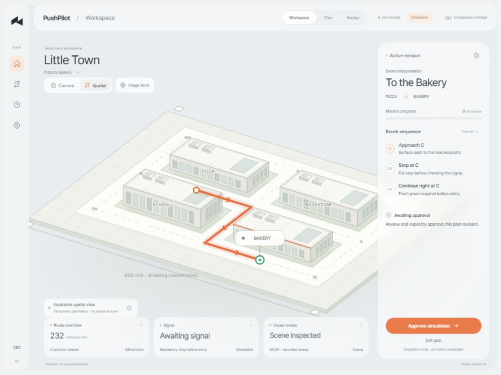
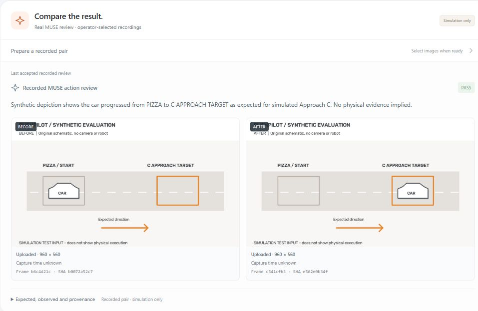

<div align="center">

# PushPilot

### A robot can finish a motion without finishing the task.

**See the scene. State the goal. Review the plan. Check the outcome.**

PushPilot connects an operator's intent, a spatial plan and visual evidence in one tablet workspace.<br>
Muse Spark selects roads from a live image and a replaceable map graph, then reviews visual outcomes; a deterministic supervisor decides what can happen next.

[See the workspace](#the-workspace) · [How Meta is used](#what-meta-adds) · [Evidence and limits](#evidence-and-limits) · [Run it](#quick-start)

<code>Live-image MUSE planning</code> &nbsp; <code>Replaceable map graph</code> &nbsp; <code>Inspectable evidence</code> &nbsp; <code>Simulated execution</code>

</div>

<p align="center">
  <a href="docs/assets/scene-workspace.jpg"></a><br>
  <sub>Actual local application · original spatial presentation of inherited drawing geometry · simulation. Recorded-image model findings appear as text; no camera photograph or supplied artwork is shown. <a href="docs/VERIFICATION.md">Verification record</a></sub>
</p>

## The workspace

Robot endpoint telemetry answers where the tool went. An operator still needs to know whether the object moved, whether the view is sufficient, and why the system is continuing or waiting. PushPilot puts those questions beside the scene instead of leaving them scattered across controller logs and model responses.

The demonstration mission pushes a wheel-less model car from **Pizza** to a named destination. Every controlled intersection requires a stop, a reviewed outcome and a fresh green signal before entry. One fixed spatial stage shows the proposed route, with rounded translucent mission and status panels floating over it. Map-derived route portions distinguish completed, current and remaining simulated actions, with junction stop, signal and review context. The current action, next check and primary decision remain in view; route history, image tools and detailed evidence use bounded dialogs, tabs and pages instead of a vertically scrolling workspace.

**Camera** is the default view, with separate **Live** and **Recorded** sources. An explicitly configured live preview is preferred when available; recorded-image tools and MUSE evidence remain separate. Both preserve the source image's perspective and overlay geometry. Optional **Board focus** masks the surrounding desk when the selected source has a valid test lock; **Full frame** restores the complete image. **Spatial map** is a deterministic illustration. The display mask adds no image detail or physical accuracy. [Live preview](docs/LIVE_CAMERA.md) does not automatically save images, call MUSE or grant motion authority.

| Observe | Plan | Approve | Act | Verify |
|---|---|---|---|---|
| Inspect a source-labelled scene. | Interpret a goal and display its route. | Approve the current plan. | Run one bounded simulated action. | Review the outcome before continuing. |

The product direction extends this **natural-language spatial interface** beyond the tablet to a future AR-glasses companion: see the workspace, state an intention, and inspect a shared plan. The current tablet application combines optional native live preview, recorded-image analysis and test-only route overlays. Voice capture, qualified spatial AR and wearable integration are future work.

## What Meta adds

### Real input. Inspectable output.

Actual goal and single-image scene requests have been exercised through the application. The [Meta API record](docs/META_API_CHECK.md) provides their conditions and scope; action-bound comparisons are shown below.

**Live-image route selection is now connected.** A deliberate planning request sends the unchanged native JPEG, projected node identities, directed graph and operator query to MUSE. The backend validates and compiles the returned node sequence into the same AR route contract. It does not replace a valid selected route with its own shortest path. In two actual prompt-v2 checks, a map-left request selected `PIZZA → W → SW → SCHOOL`; a map-right request selected the eastern loop through `C → N → NE → E → SE → BAKERY → S`. Both remained unapproved drawing previews, with no physical car present. See [live intelligence](docs/LIVE_INTELLIGENCE.md) for contracts and [provider evidence](docs/META_API_CHECK.md) for exact conditions.

| Input | Actual result | Consequence |
|---|---|---|
| `Push the car from Pizza to the Bookstore.` | Muse Spark interpreted **BOOKSTORE**. The supervisor derived a five-action temporary-map plan. | `PLAN_READY`, awaiting explicit approval. |
| A recorded 1920 × 1080 photograph of the printed Little Town map | Four printed shops identified; **no separate physical car**; paper signal **UNKNOWN**. | Stored scene evidence, without advancing the mission. |

The second case matters because printed car footprints and traffic-light decorations must not become evidence of a real car or an operator's paper signal. It is **one recorded example**, not a general image-accuracy result.

### Make the image review affect the next step

The action-review path sends an operator-selected **before/after recorded-image pair**, the current action and its expected outcome to Muse Spark. A validated result is bound to that exact mission, action, pending review and map. The supervisor then applies it to the simulated mission alongside the existing local gates.

| Review result | Supervisor behavior |
|---|---|
| **PASS** — the supplied evidence supports the expected outcome | Accept the review; continuation still requires the applicable approval, action and signal gates. |
| **FAIL** — the supplied evidence contradicts the expected outcome | Enter a visible fault. |
| **REOBSERVE / UNKNOWN** — the result cannot be established | Hold for another observation; do not replay the action. |

**Three actual MUSE calls changed the simulated next state on three original synthetic image pairs:**

| Same expected approach, different synthetic evidence | Actual MUSE result | Actual supervisor state |
|---|---|---|
| Depicted car moved into the target | PASS | READY |
| Depicted car stayed at the start | FAIL | FAULT |
| Foreground occluder hid the depicted car | REOBSERVE | REOBSERVE |

These are labelled schematic test inputs, **not real-car photographs or physical motion**. One call per case demonstrates the provider-to-state connection; it is not a held-out accuracy benchmark. Read the [actual API results](docs/META_API_CHECK.md) and [reproduction workflow](docs/ACTION_REVIEWS.md).

<p align="center">
  <a href="docs/assets/recorded-action-review.jpg"></a><br>
  <sub>Provider evidence captured before the fixed-stage layout revision · actual Meta response · original synthetic test images · simulation only.</sub>
</p>

### Model judgment + deterministic authority

**Muse Spark** interprets intent and compares the supplied visual evidence. **The supervisor** enforces current-plan approval, request/review identity, map binding, stop policy and junction-scoped signal admission. A recorded-action PASS cannot supply the separate simulated GREEN or bypass a mandatory stop. A failed provider request never silently becomes a demo PASS.

The implemented [stopped-live signal service](docs/MUSE_SIGNAL_GATE.md) makes MUSE the color judge after a matching accepted simulated stop. It selects a new image for the configured approach-specific target, waits on RED or uncertainty, and admits a simulated crossing only after stop, plan/junction/approach, frame/freshness and response bindings pass. No second local color classifier is required. A bounded wait requests new frames rather than reusing a previous signal image. Actual robot stopping and physical signal recognition remain unqualified; the current default map has no reviewed signal targets and rejects this operation until configured.

SQLite events and review records connect the input, response and resulting transition for replay. Recorded imagery, actual provider responses and simulated execution retain separate source labels.

## Evidence and limits

| Area | Available today | Evidence boundary |
|---|---|---|
| Goal understanding | Actual strict-schema Muse Spark interpretation | Real text requests reached `PLAN_READY`; approval remains separate. |
| Scene inspection | Actual Muse Spark analysis of a private recorded frame | The single shop/car/signal case above; no action authority. |
| Action-bound image review | Recorded before/after pair → MUSE result → simulated supervisor decision | Three actual synthetic-input cases above; software checks in [verification](docs/VERIFICATION.md). Real-car task accuracy is unverified. |
| Mission workflow | Three temporary graph routes, mandatory stops, red/unknown waiting, scoped green admission and replay | Software simulation; action receipts and signals are simulated. Explicit demo verdicts remain available and labelled. |
| Image presentation and route overlay | Private upload, four-marker test lock, fixed-reference projection, Camera board-focus mask, full-frame display and execution-aware route portions | Progress comes from simulation; stop lines are illustrative. The mask preserves camera perspective and geometry; raw frames stay unchanged. No car tracking, robot/BASE registration or metric accuracy claim. |
| Live camera preview | Opt-in native MJPEG helper, loopback transport, bounded RAM frames, source/age labels and explicit display-lock path | Preview only; current physical registration results belong in [verification](docs/VERIFICATION.md). No automatic MUSE submission, mission evidence, signal gate or robot observation. |
| Live MUSE planning | Native JPEG + grounded graph → selected directed nodes → validated AR geometry | Actual left/right route-preview requests accepted; no measured car pose or physical action. |
| Live action and signal services | Server-bound native BEFORE/AFTER review; new post-stop signal images and bounded RED/UNKNOWN waiting | Offline provider tests pass. Stop/action receipts remain simulated; real-car outcomes and paper-signal accuracy are unverified. |
| Voice backend | Bounded PCM WAV → Meta adapter → editable, revision-bound transcript candidate | Implemented and tested offline. Actual ASR access and browser microphone capture are not verified. |
| Robot execution | Separate future qualified adapter | Not connected. Physical pushing, turning, stopping and paper-signal operation need qualification. |
| GX10 and glasses | GX10 serves the compiled frontend and simulation backend beside the independent camera helper | Isolated application startup verified on October 28; Windows remains the development host. No robot or wearable connection; boot without login and tablet HTTPS remain unverified. |

The temporary print is replaceable through a reviewed JSON definition, map version, new plan and fresh camera display registration. Places, aliases, directed roads, marker facts and approach-specific signal regions belong to map data. Validate a candidate with `python tools/validate_map.py --map-path /private/maps/replacement.json` or `POST /api/v1/maps/validate`, then select it at startup with `--map-path`. See [map replacement](docs/MAP_REPLACEMENT.md) and [route display](docs/ROUTE_DISPLAY.md). Drawing geometry does not qualify physical stop lines, vehicle/tool clearance or contact turning. Raw map artwork, camera frames, credentials and operational archives are excluded from public source and release bundles.

See [Verification](docs/VERIFICATION.md) for completed checks, [Meta API evidence](docs/META_API_CHECK.md) for real requests, and the [Roadmap](docs/ROADMAP.md) for the next acceptance gates. Reported software tests establish the stated behavior; they do not establish physical task success or a general model-accuracy percentage.

## Quick start

Use **Python 3.12+**, **Node 24 with npm** for the local frontend build, and Git for release tests. Model credentials and robot connections are unnecessary for simulation and offline tests.

```bash
python -m venv .venv
# Activate the environment, then:
python -m pip install -r requirements.lock
cd frontend
npm ci
npm run build
cd ..
python tools/serve.py
```

Open `http://127.0.0.1:8080`. Set a Bakery, Bookstore or School goal, inspect **Spatial map**, and approve the simulation. Open **Simulation inputs** for clearly labelled demo signals and verdicts. **Plan**, **Replay**, image tools and recorded action review open within the fixed viewport. Optional recorded-image upload and actual MUSE requests use the [image-review workflow](docs/ACTION_REVIEWS.md). Save `META_API_KEY` only in the ignored backend `.env`; no provider request runs at startup.

Live preview is off by default. With an already-running authorized loopback camera service, opt in using `python tools/serve.py --live-camera-url http://127.0.0.1:8895`. This connects to that service; it does not start a camera process. See [Live camera](docs/LIVE_CAMERA.md) for the standalone helper, SSH forward, time semantics and display-only boundary.

To select a reviewed replacement map at startup, use `python tools/serve.py --map-path /private/maps/replacement.json`. This changes drawing/simulation input; it does not configure robot coordinates or reuse the previous camera lock. The bundled Little Town definition remains the default.

```bash
python tools/dev.py check
python tools/dev.py test
```

These commands perform offline verification. For Windows/Linux setup, one-worker serving and build details, read [Development](docs/DEVELOPMENT.md). GX10 serves prebuilt frontend assets with Python; it does not need Node at runtime.

## Explore the project

| Read for… | Guide |
|---|---|
| Product behavior and intersection rules | [Mission](docs/MISSION.md) |
| Model input, uncertainty and recorded-action review | [Meta intelligence](docs/META_INTELLIGENCE.md) · [Action reviews](docs/ACTION_REVIEWS.md) |
| Authority, components and data contracts | [Architecture](docs/ARCHITECTURE.md) · [Services](docs/SERVICE_COMPOSITION.md) · [Contracts](contracts/README.md) |
| Operator experience and future voice | [Design system](docs/DESIGN_SYSTEM.md) · [Frontend](frontend/README.md) · [Voice input](docs/VOICE_INPUT.md) |
| Route progress, map replacement and private inputs | [Route display](docs/ROUTE_DISPLAY.md) · [Temporary map](docs/TEMPORARY_MAP.md) · [Test inputs](docs/TEST_INPUTS.md) |
| Native live preview and fixed display registration | [Live camera](docs/LIVE_CAMERA.md) |
| Reproducible checks and isolated delivery | [Tests](tests/README.md) · [Release tools](tools/README.md) · [GX10 deployment](deploy/README.md) |
| New work, inherited foundations and rights | [Contributions](CONTRIBUTIONS.md) · [Third-party notices](THIRD_PARTY_NOTICES.md) |

The self-contained repository separates `frontend/`, `backend/`, `contracts/`, `prompts/`, `tests/`, `tools/`, `deploy/` and `docs/`. Start at the [documentation hub](docs/README.md) for component ownership and developer reading paths.

PushPilot builds on earlier tabletop experiments, existing robot transport and inherited drawing facts. This repository adds its own workspace, simulation supervisor, Meta adapters and evidence workflow; earlier physical POC results are historical context. A repository license has not yet been selected.

---

<p align="center"><strong>PushPilot · From sight to action</strong><br><sub>A shared plan. A checked outcome. An understandable next step.</sub></p>
