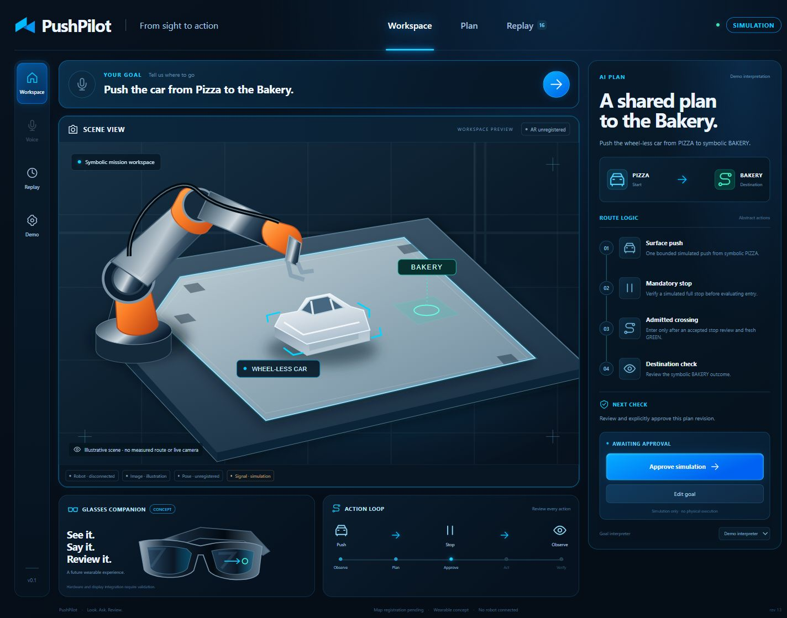
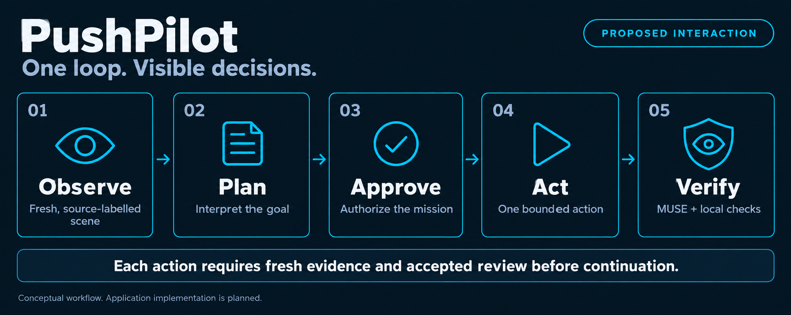

<p align="center">
  
</p>

<p align="center">
  <strong>An operator workspace for reviewable, visually grounded robot tasks.</strong><br>
  Understand the goal. Inspect the outcome. Know why the next step happens.
</p>

<p align="center">
  <a href="#why-pushpilot">Why PushPilot</a> &nbsp;·&nbsp;
  <a href="#the-interaction-loop">The workflow</a> &nbsp;·&nbsp;
  <a href="#build-status">Build status</a> &nbsp;·&nbsp;
  <a href="#quick-start">Quick start</a> &nbsp;·&nbsp;
  <a href="docs/README.md">Documentation</a>
</p>

<p align="center">
  <code>Stage: connected simulation workspace</code> &nbsp;
  <code>Runtime: Python 3.12+</code> &nbsp;
  <code>Deployment target: GX10</code>
</p>

---

## Why PushPilot

A robot reaching a commanded point does not tell an operator whether the object reached its goal. PushPilot is being built around that missing connection: **the intended task, the scene evidence and the decision to continue belong together.**

The proposed experience connects an operator's goal to a shared plan, bounded actions and fresh visual reviews through the planned Meta-model integration, MUSE. The operator can inspect what was expected, what was observed and why the application continues, waits or asks for another observation.

The initial demo design includes **text and push-to-talk goals**. A backend voice adapter transcribes a bounded recording with Meta Muse Voice Transcribe. The operator reviews or edits the original transcript, submits the goal to MUSE and explicitly approves the resulting plan. Read [voice input](docs/VOICE_INPUT.md) and [service composition](docs/SERVICE_COMPOSITION.md). Voice capture and transcription remain unimplemented and unverified.

| Understand the task | Check the outcome | Explain the next step |
|---|---|---|
| Ground the goal in the supplied scene and task context. | Compare the intended action with new evidence after it stops. | Keep the model result, local checks and resulting state change connected. |

The first use case is a controlled tabletop mission: push a wheel-less car from a named starting station to a destination, stop at controlled intersections, wait on red and enter on qualified green. It is a compact testbed for an inspectable operator workflow. A future AR-glasses companion extends the product idea beyond the tablet.

**The first connected workspace implements typed goals, plan approval, bounded simulation, mandatory-stop signal gating and evidence replay.** An opt-in backend adapter interprets goals with Muse Spark. Voice, image review, metric AR and physical execution remain future integration work. The documentation artwork describes the broader intended experience.

<p align="center">
  <a href="docs/assets/workspace-simulation.jpg"></a><br>
  <sub>Actual software screenshot · illustrated scene · simulation only. <a href="docs/VERIFICATION.md">Verification scope</a></sub>
</p>

## The interaction loop

<p align="center">
  <a href="docs/assets/interaction-loop.png">
  
  </a>
</p>

1. **Observe** — obtain a source-labelled scene and the operator's goal.
2. **Plan** — interpret the task and prepare an explanation the operator can review.
3. **Approve** — bind the reviewed task to the current context.
4. **Act** — perform one bounded, qualified action through the execution boundary.
5. **Verify** — compare fresh observations with the expected outcome, then continue, wait or reobserve.

MUSE provides semantic interpretation and outcome review in the proposed integration. The supervisor enforces deterministic state, freshness, traffic and qualification checks. A model result does not directly issue robot scripts or authoritative coordinates.

### A mission with visible decisions

| Moment | Operator experience | Decision rule |
|---|---|---|
| State a goal | `Push the car to the bakery.` | Ground the request in supplied task context. |
| Review the plan | A shared task and its expected outcomes. | Approval applies to the current task/context. |
| Finish an action | `Expected / Observed` with a new image and model result. | Accept the reviewed outcome and required local checks before continuing. |
| Reach a controlled approach | `Stopped at stop line` | Always stop first, including on green arrival. |
| Observe red or an unclear signal | `Waiting for green` or `Signal unclear · Waiting` | Remain stopped; card exchange or occlusion cannot imply green. |
| Confirm green | `Crossing intersection` | Fresh green and accepted entry checks permit automatic entry. |
| Reach the destination | A final outcome and its evidence. | Measured completion and the required review establish success. |

The signal source is operator-switched red/green paper. Each bounded contact action requires a fresh-image MUSE review in the planned integration. Ordinary waiting and execution faults are separate states. Read the [mission specification](docs/MISSION.md).

## What makes the model useful

The product is designed to show five concise pieces of information together:

> **Goal understood** → **Scene evidence** → **Expected / Observed** → **MUSE decision** → **Next check**

A useful review can identify no progress, an unexpected outcome or insufficient visibility and change what happens next. Evidence is retained so that the operator can inspect the decision. A successful-looking caption over predetermined motion is not the intended integration.

The planned evidence model records source identity independently for the robot, image, object pose, signal and model result. An actual Meta response over a recorded image is a real provider test; it does not turn simulated motion into physical execution. Read [Meta intelligence and evidence](docs/META_INTELLIGENCE.md).

## Build status

| Area | Status | What is available now |
|---|---|---|
| Repository structure and component ownership | **Ready** | Standalone workspace with component guides and development rules. |
| Equipment-free checks | **Ready** | Source checks, release tests, mocked provider/API tests and mission transition scenarios. |
| Source-release tooling | **Ready** | Clean-commit packaging, file hashes and archive verification. |
| Meta API connectivity | **Verified: text only** | Authenticated model discovery and a real Muse Spark completion; [scope and command](docs/META_API_CHECK.md). |
| Mission backend and abstract simulator | **Implemented** | SQLite state/evidence, approval, bounded actions, stop/review/signal gate and restart recovery. |
| Operator frontend and evidence replay | **Implemented** | Responsive English React workspace connected to revisioned backend state and event history. |
| MUSE goal interpretation | **Verified: text only** | Backend-only strict-schema Muse Spark adapter; explicit opt-in and no scripted fallback. |
| Fresh-image MUSE outcome review | **Planned** | Current outcome verdicts are explicitly operator-injected demo inputs. |
| Voice goal input | **Planned: initial demo** | Push-to-talk, backend transcription, editable text and explicit plan approval are designed; no voice API call has been verified. |
| Final map, metric AR and robot integration | **Deferred** | Awaiting the final installed map and physical qualification. |
| AR-glasses companion | **Concept** | Future experience; no wearable integration is claimed. |

**Verification covers software simulation and request boundaries.** Mission tests exercise mandatory stopping, red/unknown/stale inhibition, automatic green admission, uncertainty, faults, idempotency and restart recovery. A real structured [MUSE goal check](docs/META_API_CHECK.md) also reached `PLAN_READY`. These checks do not establish image accuracy or physical-robot results.

Final road geometry and physical placement are unresolved. Current development uses symbolic locations, abstract actions and explicitly labelled test inputs. Map-specific routes, calibration, stop lines, signal regions and spatial AR remain deferred. The [temporary print candidate](docs/TEST_INPUTS.md) is documented separately and its artwork is not embedded as a production dependency.

## Quick start

### Prerequisites

- **Python 3.12 or newer** and the packages in `requirements.lock`.
- **Node 24 and npm** to build the frontend locally; GX10 serves the built assets without Node.
- **Git** available on your command path. Release tests create isolated local Git fixtures.
- Model credentials and robot connections are not required for simulation or offline tests.

From the repository root:

```bash
python -m venv .venv
# Activate the environment, then:
python -m pip install -r requirements.lock
cd frontend
npm ci
npm run build
cd ..
python tools/serve.py
```

Open `http://127.0.0.1:8080`. Submit a Bakery goal with **Demo interpreter**, approve the plan and advance the symbolic actions. Open **Demo** for labelled review verdicts and signal observations. Accepted stopping plus fresh GREEN admits the crossing automatically.

Run offline verification separately:

```bash
python tools/dev.py check
python tools/dev.py test
```

The checks do not start an application, contact a model or operate equipment. The workspace defaults to loopback and makes no provider request at startup. Save `META_API_KEY` only in the ignored server-side `.env` to enable the explicit MUSE goal option.

For Windows/Linux commands, exact state behavior and GX10 delivery, read [Development](docs/DEVELOPMENT.md).

### Create a source release

After committing the reviewed source, keep the working tree clean and choose a new output path outside the repository:

```bash
python -c "from pathlib import Path; Path('../release-bundles').mkdir(exist_ok=True)"
python tools/build_release.py --output ../release-bundles/pushpilot-source.zip
python tools/build_release.py --verify ../release-bundles/pushpilot-source.zip
```

The builder uses committed, allowlisted source and writes a Git-bound SHA-256 manifest. It rejects dirty source, private paths and unsupported file types. Verification does not extract files or authenticate a publisher. Use a new filename for each release; existing output is not overwritten.

This creates a **source bundle**, not a deployed service. Read [Release tooling](tools/README.md) and [GX10 deployment](deploy/README.md) for the exact boundaries.

## Repository structure

```text
.
├── frontend/             Operator workspace and presentation boundary
├── backend/              Mission, model/provider and evidence boundary
├── contracts/            Versioned cross-component interfaces
├── prompts/              Versioned English model instructions
├── tests/                Bootstrap and future application verification
├── tools/                Equipment-free checks and source-release tools
├── deploy/               Isolated GX10 release plan and example config
├── docs/
│   ├── README.md         Documentation hub
│   ├── ARCHITECTURE.md   Components, authority and source boundaries
│   ├── MISSION.md        Behavior and signal-entry rules
│   ├── META_INTELLIGENCE.md
│   ├── DEVELOPMENT.md    Local workflow and release preparation
│   ├── ROADMAP.md        Milestones and acceptance gates
│   └── assets/           Original repository illustrations
├── CONTRIBUTING.md       Development and review guide
├── CONTRIBUTIONS.md      Origin, status and new-work disclosure
├── THIRD_PARTY_NOTICES.md
├── AGENTS.md             Development instructions
└── pyproject.toml        Current tooling requirements
```

Component readmes distinguish implemented runtime files from the remaining voice, image-review and physical adapters. The versioned workspace interface lives in [`contracts/workspace.ts`](contracts/workspace.ts).

| Start here if you want to… | Read |
|---|---|
| Understand the system and authority boundaries | [Architecture](docs/ARCHITECTURE.md) |
| Inspect service boundaries or voice goal input | [Service composition](docs/SERVICE_COMPOSITION.md) · [Voice input](docs/VOICE_INPUT.md) |
| Inspect pushing, waiting and verification behavior | [Mission](docs/MISSION.md) |
| Understand MUSE's role and evidence requirements | [Meta intelligence](docs/META_INTELLIGENCE.md) |
| Work on the operator interface | [Frontend](frontend/README.md) |
| Work on task and provider services | [Backend](backend/README.md) |
| Review schemas or model instructions | [Contracts](contracts/README.md) · [Prompts](prompts/README.md) |
| Run checks or prepare a source bundle | [Tests](tests/README.md) · [Tools](tools/README.md) |
| Understand the delivery sequence | [Roadmap](docs/ROADMAP.md) · [Deployment](deploy/README.md) |

## Local development → GitHub → GX10

The local repository is the development source. GitHub records reviewed source and history. GX10 is the deployment target for a specific verified release.

The proposed target separates immutable `releases/` from runtime configuration, credentials, evidence and logs in `shared/`, with a `current` pointer to the active version. The scaffold does not transfer files, create remote directories or start services. Existing camera and robot environments retain their ownership.

Deployment requires an actual runtime, a verified target environment and a release activation procedure. Read [Deployment](deploy/README.md); example configuration is a proposal, not a record of a configured host.

## Roadmap and contribution history

The next milestone is a complete **map-independent software loop**: text and push-to-talk goals, abstract mission events, genuine Meta interaction, visible decisions and source-labelled replay. Final map and robot acceptance follow the physical setup gate. Streaming speech, spoken status, extra destinations, segmentation and wearable hardware are later options.

PushPilot builds on earlier tabletop experiments and an existing robot-transport foundation. Those materials have not been copied into this standalone application scaffold. The workspace, tools and documentation are recorded separately; later imports and implemented features must identify their origin, changes and evidence.

Read the [Roadmap](docs/ROADMAP.md), [Contributing guide](CONTRIBUTING.md), [Contribution record](CONTRIBUTIONS.md) and [Third-party notices](THIRD_PARTY_NOTICES.md). The header is an original repository vector. Generated process illustrations describe the proposed design; they are not camera captures or working-product screenshots.

**License:** a repository license has not yet been selected. Consult [Third-party notices](THIRD_PARTY_NOTICES.md) before reuse or importing material.

---

<p align="center">
  <strong>PushPilot · From sight to action</strong><br>
  <sub>A shared plan. A checked outcome. An understandable next step.</sub>
</p>
