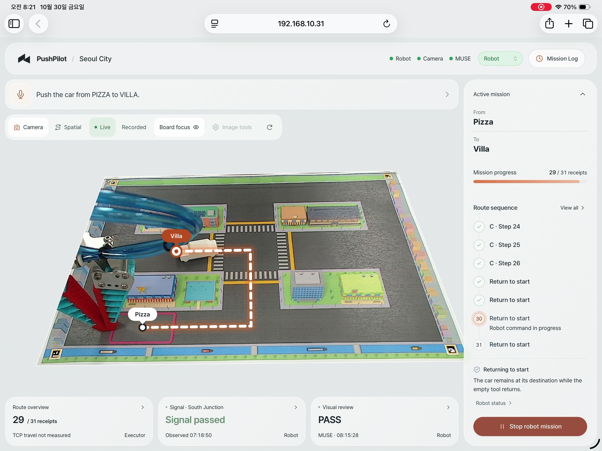
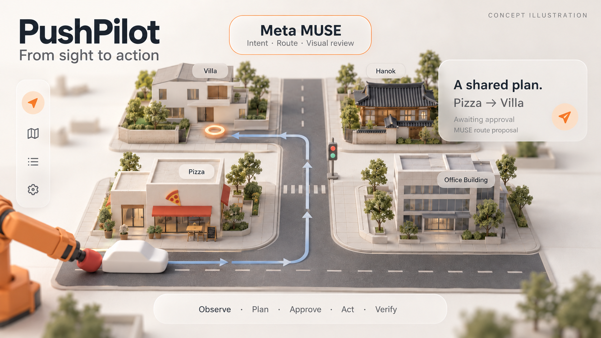

<div align="center">

# PushPilot

### Give the robot a goal. See the plan. Review the result.

A **Meta Muse Spark 1.3** workspace for operators running robot demos and pilot tasks,<br>
bringing the goal, execution feedback and visual result into one view.

[Watch the physical recording](https://drive.google.com/file/d/1Hflx4wuoLFTQvOuHA_Aqk8_FBQhNt1bp/view) · [Explore 3 recorded Muse decisions](https://jominsu-ku.github.io/PushPilot/) · [How MUSE is used](#how-muse-changes-the-next-step)

</div>

<p align="center">
  <a href="https://drive.google.com/file/d/1Hflx4wuoLFTQvOuHA_Aqk8_FBQhNt1bp/view"></a><br>
  <sub>Actual tablet capture · click to watch. This short recording shows the car at Villa and the empty robot returning; the PASS is the last recorded MUSE review. It does not show the entire delivery. <a href="docs/DEMO.md#watch-the-physical-recordings">Recording guide</a> · <a href="docs/assets/PHYSICAL_MEDIA.md">Source and extraction</a></sub>
</p>

*Current demonstrator: a tabletop robot pushing a wheel-less model car along taught routes, with operator approval and visual outcome review.*

## Did the motion finish—or did the task succeed?

**A robot can finish a motion without finishing the task.** A completed command tells the operator where the tool went. It does not establish that a freely sliding car reached the intended place.

Our initial users are operators running robot demos and pilot tasks. They can follow the goal, controller feedback and visual result together, without reconstructing the trial across separate logs and camera views. PushPilot shows the basis for continuing, observing again or holding. This is the initial user hypothesis; broader customer validation remains future work.

## How MUSE changes the next step

**The useful output is a decision connected to the task.**

| Task moment | What Meta MUSE interprets | What the operator can understand |
|---|---|---|
| **Before motion** | The goal, selected map graph and original scene image | The proposed destination and route before approval. |
| **At the signal stop** | Fresh observations of the selected paper signal | Why the system waits for RED/uncertainty or admits departure after accepted GREEN. |
| **After an action unit** | Expected outcome and source-bound observations of the car | Whether there is visible progress, a clear problem, insufficient evidence or arrival. |

MUSE interprets the request and visual evidence; a supervised executor carries out reviewed robot motions. Source identity, fresh evidence, controller completion and the applicable signal/mission checks determine whether a judgment can advance execution. [Technical boundaries](docs/META_INTELLIGENCE.md)

**Same expected action. Different observations. Different recorded states.**

| Observed input | Actual MUSE response | Recorded supervisor state |
|---|---|---|
| The depicted car reaches the approach target | **PASS** | **READY** — the simulated action's review is accepted. |
| The depicted car stays in place | **FAIL** | **FAULT** — the expected outcome is rejected. |
| An occluder hides the relevant area | **REOBSERVE** | **REOBSERVE** — another observation is needed. |

These are **three actual Meta API responses on synthetic before/after inputs**, recorded October 27, 2026, with one designed case per condition. They demonstrate the review-to-state connection in simulation, not physical recognition accuracy. [Inspect the inputs and exact responses](docs/DEMO.md#explore-three-recorded-decisions) · [Original result record](docs/evidence/synthetic-action-reviews-20261027.json)

## One task, one understandable loop

| Observe | Plan | Approve | Act | Verify |
|---|---|---|---|---|
| See the scene and its source. | MUSE interprets the goal and proposes a route. | Review and start the selected mission. | Execute a reviewed coordinate action unit. | Compare controller completion with the visible result. |

In the current City A3 demonstrator, the car always starts **in front of Pizza**. Office Building is the direct frontage destination; Villa and Hanok share the first northbound approach before branching. At the configured paper-signal stop, the tool clears the right-side view, MUSE reviews the signal, and an accepted GREEN admits measured recontact and departure. A new mission needs a new admission.

Camera shows the actual perspective with an AR route. Spatial shows the same selected drawing route on the city model; its optional car animation is labelled an **execution estimate**, not measured tracking. [Mission](docs/MISSION.md) · [Signal behavior](docs/SINGLE_SIGNAL_DEPARTURE.md) · [Camera/Spatial routes](docs/ROUTE_DISPLAY.md)

## What the evidence supports

| Evidence | Supported result |
|---|---|
| **Physical robot trials** | Historical Office, Villa and Hanok arrivals are recorded. Office has an actual MUSE arrival review; Villa's earlier arrival was accepted by the operator with its negative model judgment preserved; Hanok has an original-image arrival PASS after recovery trials. [Physical evidence guide](docs/DEMO.md#read-the-physical-evidence) |
| **Actual Meta integration** | `muse-spark-1.3` goal, graph/image planning and visual-review integration, with dated provider records. [API record](docs/META_API_CHECK.md) |
| **Software verification · recovery checkpoint `bcac769` · November 2** | The published recovery record reports 1,199 backend tests run, five skipped and zero failures; 143 frontend tests and the production build passed. These are software checks, not a physical success rate. [Checkpoint evidence](docs/evidence/native-read-recovery-20261102.json) · [Verification](docs/VERIFICATION.md) |
| **Current scope** | An explicitly configured, supervised tabletop site trial. Derived recipes are not qualified for general unattended repeatability; numeric straightening and parallel parking are deferred. [Current status](docs/CURRENT_STATUS.md) |

The short recording above is a later tablet capture. It is not substituted for the separate October 29 B/C/D records or presented as one uninterrupted proof of every route.

## How it is built

**MUSE interprets intent and visual evidence. The supervisor admits actions. The executor follows taught BASE coordinates. Native/controller receipts verify robot completion.**

The graph used for display and planning is separate from the private reviewed robot-motion packet. After contact, the tool withdraws for an outcome review; an overlay or model-generated route never becomes arbitrary TCP commands. Source-bound events connect the goal, action, observation, judgment and next state for replay.

[Architecture](docs/ARCHITECTURE.md) · [MUSE integration](docs/META_INTELLIGENCE.md) · [Service boundaries](docs/SERVICE_COMPOSITION.md)

## What this repository adds

- **A tablet workspace** joining intent, Camera/Spatial routes, actual execution state and visual review.
- **Meta MUSE integration** for graph-grounded planning and source-bound signal/outcome judgments.
- **Mission supervision and orchestration** connecting reviewed coordinate units, controller receipts, observation and explicit recovery.
- **Inspectable evidence and release tools**, with simulation, recorded-provider checks and physical records kept distinct.

The work builds on earlier tabletop experiments, inherited robot transport and supplied map/model material. [Contribution record](CONTRIBUTIONS.md) · [Inherited material](THIRD_PARTY_NOTICES.md)

## Try the recorded review

**[Explore 3 recorded Muse decisions →](https://jominsu-ku.github.io/PushPilot/)**

Open the page and select **Progress visible**, **No progress** or **View occluded** to compare the original input pair, MUSE response and resulting simulated state. No download, equipment or API key is required. These are archived synthetic-input cases; the page does not run new inference or operate equipment. [Recording and evidence guide](docs/DEMO.md)

For offline use, clone/download the repository and open [`docs/review/index.html`](docs/review/index.html) directly in a browser.

<details>
<summary><strong>Developer setup · run the application locally</strong></summary>

Use Python 3.12+, Node 24 with npm for frontend builds, and Git.

```bash
python -m venv .venv
# Activate the environment, then:
python -m pip install -r requirements.lock
cd frontend
npm ci
npm run build
cd ..
python tools/serve.py --map-path backend/data/seoul-city-a3.json
```

Open `http://127.0.0.1:8080` and explicitly select **Simulation** in Execution mode for an equipment-free run. The UI initially selects Robot and does not automatically fall back. Live MUSE planning needs a deliberately configured backend key; the recorded explorer above does not. Private camera/model assets are installed separately.

Save `META_API_KEY` in the ignored repository-root `.env`. A physical trial additionally requires the selected private `PUSHPILOT_PHYSICAL_CONFIG`, current site data and explicit readiness.

[Development](docs/DEVELOPMENT.md) · [GX10 deployment](deploy/README.md) · [Private Spatial setup](docs/SPATIAL_3D.md)

</details>

## Scope and further reading

Current operation prioritizes delivery and empty-tool return. Runtime/camera failures can still require a hold and explicit recovery; software tests do not establish contact-mechanics repeatability. Browser microphone capture, actual ASR acceptance and wearable integration remain pending. For another task, the site geometry, reviewed motion recipes and observation/acceptance criteria must be established again.

[All documentation](docs/README.md) · [Current status](docs/CURRENT_STATUS.md) · [Known limitations](docs/KNOWN_LIMITATIONS.md) · [Robot operations](docs/ROBOT_OPERATIONS.md) · [C review policies](docs/C_INTERMEDIATE_PROGRESS_REVIEW.md) · [Design system](docs/DESIGN_SYSTEM.md) · [Contributing](CONTRIBUTING.md)

<details>
<summary><strong>Product vision · From sight to action</strong></summary>

The original vision extends the same intent–plan–action–review loop to other prepared robot tasks and, later, a glasses companion. The illustration below expresses that direction; the actual demonstrator and recorded evidence appear above.



*Original generated concept illustration, not an application screenshot or physical-success record.* [Artwork provenance](docs/assets/README.md)

</details>

---

<p align="center"><strong>PushPilot · From sight to action</strong><br><sub>A shared plan. A checked outcome. An understandable next step.</sub></p>
