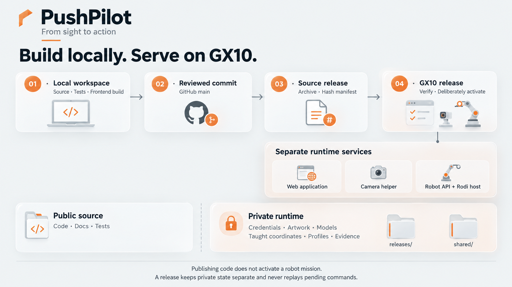

<sub>[PushPilot](../README.md) / Delivery / GX10</sub>

# Build locally. Serve on GX10.

**One Python web service hosts the compiled workspace, simulation and the optional configured physical-mission coordinator. Node is a local build dependency.**

Meta MUSE connects the visual scene to mission decisions: it interprets the goal/route, reviews visible vehicle progress after coordinate withdrawal, identifies the paper signal at the stopped observation pose and assesses destination arrival. The supervisor applies those bound results together with Native receipts and local gates; the executor retains coordinate authority.

[Development](../docs/DEVELOPMENT.md) · [Release tools](../tools/README.md) · [Architecture](../docs/ARCHITECTURE.md)

The separate [robot-control deployment guide](ROBOT_CONTROL.md) covers the commissioning API and persistent host. The configured main application now connects an opt-in Robot mission to those guarded real ports; ordinary simulation remains separate. Web deployment does not start or restart the camera, Rodi or robot API.

> **Historical first application deployment, October 28, 2026:** the frontend and simulation backend from source commit `e5637f3` were installed and started in a separate GX10 release. One Python process serves the locally compiled frontend and API on loopback, using fresh shared state and the independently running native camera helper. Windows remains the development host. Existing POC services remain outside this deployment. See [verification](../docs/VERIFICATION.md#gx10-application-deployment-october-28) and [live camera](../docs/LIVE_CAMERA.md).

## Current source and last inspected deployment

**Reviewed November 2, 2026.** Public baseline `7aa7753` includes C11 recovery, mission retirement/reset and session START precision binding. The last read-only host audit identified web release `20261031-c11-activation-fix`. These are separate identities: a Git push does not change an active symlink, restart services or prove a connected robot. No deployment or hardware action is performed by this documentation update.

| Process / artifact | Last documented role | Access / boundary |
| --- | --- | --- |
| `pushpilot-main.service` | Python web API, compiled UI, physical coordinator and actual display collector | Web loopback 8080; deliberately configured LAN proxy can expose the same origin. |
| Native camera preview helper | Independent 1920 × 1080 JPEG source | Loopback 8084 in the inspected deployment; not started by the web launcher. |
| `pushpilot-robot-control.service` | Separate authenticated commissioning API | Loopback 8897; private token and durable ledger. Verify its exact active source independently. |
| `pushpilot-rodi-host.service` / explicit host process | One persistent pendant owner | Reviewed pendant listener 19507; local PLAY and actual current profile required. |
| Controller Native FC03 | Read-only state/endpoints | Controller port 502; the host owns normal acquisition. |
| `docs/data/robot-runtime-source.json` | Public provenance for exact privately imported runtime bytes | Hash manifest only; runtime source, operational geometry and mailboxes are excluded. |

A readiness check is point-in-time. The known idle Native-read failure can still close a Rodi session; source publication and the 120-second wrist budget do not repair it. See [operations](../docs/ROBOT_OPERATIONS.md) and [limitations](../docs/KNOWN_LIMITATIONS.md).

## Verified runtime direction

| Item | Observed or selected behavior |
| :--- | :--- |
| GX10 host | Ubuntu 24.04.4 LTS, `aarch64`. |
| Host Python | `/usr/bin/python3`, Python 3.12.3. |
| Host JavaScript tools | `node` and `npm` were absent from the inspected `PATH`. |
| Application runtime | One Python process, FastAPI/Uvicorn, one worker, SQLite; OpenCV/NumPy for uploaded-image marker geometry. |
| Frontend delivery | Compile locally; copy `frontend/dist` into the matching release. Python serves these static assets. |
| Hardware integration | Explicit private Robot site-trial configuration connects coordinate units, Native receipts and Meta MUSE outcome review. Default simulation needs no hardware. Application deployment does not start camera/Rodi services. |

Resolve the existing SSH alias **`gx10`** through local SSH configuration. Keep account names, addresses, credentials, and operating profiles out of public source. Recheck occupied ports, disk availability, permissions, and service state immediately before a real deployment; the read-only inspection is a point-in-time observation.

## Prepare the application locally

Use Node 24 for the frontend build and Python 3.12 or newer for the backend. Install the exact declared dependencies in an isolated environment, then run the checks in [Development](../docs/DEVELOPMENT.md).

```sh
cd frontend
npm ci
npm run build
cd ..
python tools/dev.py check
python tools/dev.py test
python tools/serve.py --host 127.0.0.1 --port 8080
```

The last command requires the active Python environment to contain `requirements.lock`. It starts only this application. Visit `http://127.0.0.1:8080` and `http://127.0.0.1:8080/api/health`. Without physical configuration, health identifies the equipment-free simulation; `camera_preview_connected` independently reports the optional native preview. Inspect `/api/v1/physical/status` and its availability/blockers for configured Robot readiness rather than treating a generic web-health response as a motion admission. The launcher does not contact Meta until an explicit provider-backed request is submitted.

`--api-only` allows backend development before the frontend is built. `--state-path /absolute/path/workspace.sqlite3` selects a persistent SQLite file. The default is ignored `runtime/workspace.sqlite3` inside the application directory; use dedicated shared state for a host installation.

`--live-camera-url http://127.0.0.1:8895` optionally connects to an already-running numeric loopback preview service or SSH forward; `PUSHPILOT_LIVE_CAMERA_URL` is the corresponding process-environment setting. It does not open a device, transfer the helper or start camera processes. The deployed GX10 application connects directly to the existing helper at `http://127.0.0.1:8084`; a Windows development instance may use the SSH-forwarded endpoint instead. Preview frames and the active display mapping remain in memory; an authentic saved reference receipt can be explicitly resumed after current-view validation. No preview result authorizes robot motion.

## Source release and compiled assets

[](../docs/assets/delivery-current.png)

*Current delivery flow: locally build and verify a committed snapshot, combine it with matching compiled/private assets, then deliberately activate an isolated GX10 release. The older [October concept graphic](../docs/assets/delivery-flow.png) is design history. Trusted tablet HTTPS remains separate; the launcher does not provision or activate the host.*

After reviewing and committing source, build a clean source snapshot:

```sh
python -c "from pathlib import Path; Path('../release-bundles').mkdir(parents=True, exist_ok=True)"
python tools/build_release.py --output ../release-bundles/pushpilot-source-v0.1.0.zip
python tools/build_release.py --verify ../release-bundles/pushpilot-source-v0.1.0.zip
```

The ZIP identifies the exact committed HEAD and source hashes. It intentionally excludes ignored `frontend/dist`, `.venv`, `.env`, runtime databases, and `node_modules`. **A source ZIP alone is not a complete runnable frontend release.**

For a deployment, build `frontend/dist` from a clean checkout of that same commit using `npm ci` and `npm run build`. Record the commit, Node/npm versions, lockfile hash, and a SHA-256 inventory of the compiled assets alongside the reviewed source manifest. Transfer both reviewed source and those compiled assets into one new release directory. Do not substitute assets left over from a different working tree. This repository currently provides no application-bundle builder or transfer command.

## Private deployment prerequisites

A source ZIP plus `frontend/dist` reproduces public application code, not the entire installed demonstration. Prepare these host-only inputs through the existing reviewed process:

- A restricted server environment containing the Meta MUSE key (`META_API_KEY`), shared SQLite/scene storage and the selected map identity. Keys never enter frontend variables or Git.
- An already-running native camera helper and the explicit current camera/reference registration. Preserve exact image provenance; restarting a web release is not permission to refit or restart the camera.
- If Spatial 3D is required, the matching private GLB/static assets bound to the current model manifest. Original models and map artwork are not source-bundle contents; follow [Spatial installation](../docs/SPATIAL_3D.md) rather than assuming an old model installer matches the current viewer.
- For Robot mode, the private hash-verified inherited runtime, original teaching packet, current site review, per-unit profile coverage, signal target/observation configuration, private journals and control-token file. Synthetic tests/templates are never hardware profiles.
- Explicit `PUSHPILOT_PHYSICAL_CONFIG=/absolute/private/site-trial-config.json` in the reviewed web-process environment for opt-in physical operation. The selected schema can be `pushpilot.site-trial-driver.v1`; absence leaves physical execution disabled. Default source examples intentionally omit it.

Keep these inputs outside release ZIPs and public manifests. Back up actual private state; do not restore an old mission database, profile, UUID or mailbox as a deployment shortcut.

## Isolated host layout

Select and verify a dedicated `<deploy-root>` before installing anything:

```text
<deploy-root>/
├── releases/
│   └── <release-id>/
│       ├── backend/
│       ├── frontend/dist/       Compiled from this release's source commit
│       ├── tools/
│       ├── requirements.lock
│       └── .venv/               Python environment isolated per release
├── current -> releases/<id>     Deliberately selected active release
└── shared/
    ├── config/                  Host-only configuration
    ├── secrets/application.env  Server credentials; owner-readable only
    ├── state/
    │   ├── workspace.sqlite3   Mission state, events and command receipts
    │   └── scene/              Private frames, locked views and inspections
    └── logs/                    Restricted application logs
```

[`gx10.example.json`](gx10.example.json) and [`pushpilot.service.example`](pushpilot.service.example) describe this arrangement. They are minimal **simulation-only deployment examples**, not the full installed Robot configuration. In particular, the example JSON's `physical_execution_implemented: false` describes its unconfigured scope, not the current repository's optional implementation. They are not installed configuration. Replace every placeholder and review paths, ownership, bind address, and port before use. The service example uses a normal application user, loopback binding, shared state, no automatic restart, and a manually managed environment file.

The isolated Python installation, after a verified transfer, follows this pattern:

```sh
python3 -m venv .venv
.venv/bin/python -m pip install -r requirements.lock
.venv/bin/python tools/serve.py --host 127.0.0.1 --port 8080 \
  --state-path /absolute/deploy-root/shared/state/workspace.sqlite3
```

The October 28 release installed all 20 locked ARM64 wheels offline in its isolated environment. Dependency consistency, runtime imports, source checks and offline tests passed; the frontend, API and existing native camera connection were verified. A separate bounded text-only MUSE connectivity smoke passed; no image, action or signal inference was part of deployment. These checks do not qualify live signal recognition, physical motion or tablet HTTPS. Repeat the relevant checks for each new release. Do not change or restart another application's services if a dependency or port is unavailable.

## Access, credentials, and microphone capture

The launcher binds `127.0.0.1` by default. LAN access requires an explicit host address and reviewed network access. Use a reverse proxy or another deliberately provisioned TLS endpoint for target-device HTTPS. No proxy, firewall, certificate, or service-manager change is performed by the application.

### Direct LAN access without restarting the workspace

The user authorized direct GX10-IP access on October 28. A separate user socket can bind the reviewed LAN address on port 8080 and pass TCP bytes through the host's installed `systemd-socket-proxyd` to the existing loopback web service. This keeps the application's current process, mission state, live camera epoch and fixed display mapping intact. Frontend/API/image URLs remain same-origin and native JPEGs are not decoded or recompressed by the proxy.

**Verified October 28, 09:47 KST:** the wired-LAN socket is enabled and direct `http://<GX10_LAN_IP>:8080/` access works from the development PC. The frontend and the same selected native 1920 × 1080 frame match the existing SSH path byte for byte. Main application and robot API processes, camera epoch, registration identity/matrix and workspace state were retained without restarting them. This access check does not establish current scene registration validity; see [the scoped record](../docs/evidence/lan-access-20261028.json).

Render [`pushpilot-lan.socket.example`](pushpilot-lan.socket.example) with the actual reviewed LAN IP and pair it with [`pushpilot-lan.service.example`](pushpilot-lan.service.example). Verify the proxy binary path on the target, then validate and enable only the new user socket. A specific LAN-IP bind coexists with the application's loopback bind; do not replace it with an all-interface bind on the same port. The service is socket-activated and limits concurrent proxy connections to 128. It does not own or start the application, camera, Rodi or robot API.

The LAN endpoint exposes the existing same-origin workspace and application API, including explicitly configured Robot controls, to devices able to reach that configured address. The camera helper and authenticated commissioning API retain their loopback bindings. Existing SSH forwarding remains usable. No firewall, router, boot/login policy or HTTPS configuration is changed by this arrangement. Plain LAN HTTP is not a secure microphone context.

The backend accepts `META_API_KEY` from its process environment or the application-local ignored `.env`. For a host service, put the key into its restricted environment file through the existing direct-input workflow. The key does not belong in frontend build variables or copied public assets. No credentials are needed for the graph simulator, frame upload, or marker detection. Actual goal interpretation and scene inspection require the server key. Independent scene inspection never advances a mission. The separate bound physical observer can inform progress, signal and arrival decisions only within its selected live Robot mission.

`PUSHPILOT_MAP_PATH` optionally selects a validated temporary map JSON; bundled drawing facts live under `backend/data/`, without the original artwork. `PUSHPILOT_SCENE_DIR` optionally selects private media storage; its default `scene/` directory is beside SQLite, so the shared-state layout keeps both together. If using another path, include its deliberate permissions/backups and any service write allowance. Map-hash changes invalidate incompatible plans and recorded-view references. Raw photos, original PDF artwork, and scene files do not enter source bundles.

Future push-to-talk recording requires HTTPS trusted by the actual tablet, microphone permission, and secure-context preflight. Plain LAN HTTP is not microphone-ready. Voice capture and audio normalization remain separate implementation and verification gates; serving the workspace successfully does not establish them.

## Activation and recovery

Before activation, verify health, frontend assets, exact source labels, RED waiting, fresh GREEN admission after a mandatory stop, uncertainty handling and replay using separate simulation/test state. For an explicitly selected Robot release, also validate its private packet/review hashes, current-source readiness, one-time signal policy, known recovery state and no pending/unknown movement without starting a loaded course. Select a release only after its checks and the corresponding deployment authorization.

The deployed application has an enabled user systemd service. It starts with the user session; `Linger=no`, so startup after boot without login has not been established. The service does not own or restart the camera helper or Rodi.

On application restart, active mission state enters recovery and requires reconciliation. Use [Robot operations](../docs/ROBOT_OPERATIONS.md): `/physical/reset` retires an ended mission only after independent START proof and does not move the robot; explicit review resume and C11 boundary preparation are narrower operations, not automatic restart. Previously approved plans, GREEN observations, or pending work do not regain authority automatically. Preserve shared evidence when changing or rolling back code; never restore a historical database merely to replay a mission. No autostart, service installation, service restart, or active-release change is performed by these tools.

Keep the POC web, motion-test, camera, and persistent receiver environments intact. UI HOLD, process exit, and service shutdown do not establish an immediate physical robot stop.

---

[Mission gates](../docs/MISSION.md) · [Test evidence](../tests/README.md) · [Roadmap](../docs/ROADMAP.md)
