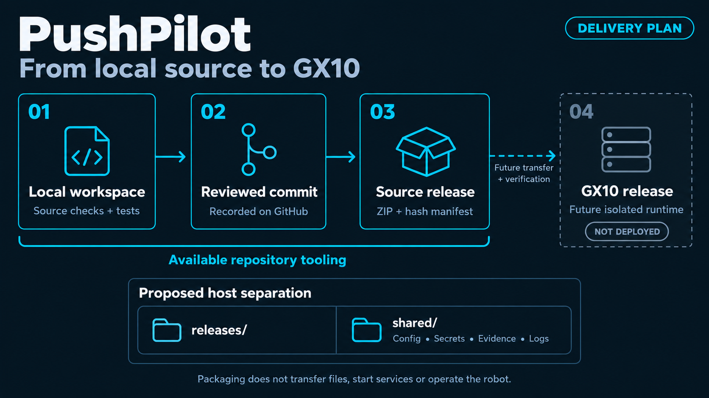

<sub>[PushPilot](../README.md) / Delivery / GX10</sub>

# Build locally. Serve on GX10.

**One Python service hosts the simulation API and the compiled operator workspace. Node is a build dependency.**

[Development](../docs/DEVELOPMENT.md) · [Release tools](../tools/README.md) · [Architecture](../docs/ARCHITECTURE.md)

> **Deployment status:** read-only host inspection completed on October 27, 2026. This application has not been installed, activated, or started on GX10. Existing POC services are outside its deployment boundary.

## Verified runtime direction

| Item | Observed or selected behavior |
| :--- | :--- |
| GX10 host | Ubuntu 24.04.4 LTS, `aarch64`. |
| Host Python | `/usr/bin/python3`, Python 3.12.3. |
| Host JavaScript tools | `node` and `npm` were absent from the inspected `PATH`. |
| Application runtime | One Python process, FastAPI/Uvicorn, one worker, SQLite. |
| Frontend delivery | Compile locally; copy `frontend/dist` into the matching release. Python serves these static assets. |
| Hardware integration | Unavailable. No robot, camera, or Rodi startup is included. |

Resolve the existing SSH alias **`gx10`** through local SSH configuration. Keep account names, addresses, credentials, and operating profiles out of public source. Recheck occupied ports, disk availability, permissions, and service state immediately before a real deployment; the read-only inspection is a point-in-time observation.

## Prepare the application locally

Use Node 24 for the frontend build and Python 3.12 or newer for the backend. Install the exact declared dependencies in an isolated environment, then run the checks in [Development](../docs/DEVELOPMENT.md).

```sh
cd frontend
npm ci
npm run build
cd ..
python tools/dev.py check
python tools/dev.py test
python tools/serve.py --host 127.0.0.1 --port 8080
```

The last command requires the active Python environment to contain `requirements.lock`. It starts only this application. Visit `http://127.0.0.1:8080` and `http://127.0.0.1:8080/api/health`. The health response identifies simulation mode and disconnected hardware. The launcher does not contact Meta until an explicit provider-backed request is submitted.

`--api-only` allows backend development before the frontend is built. `--state-path /absolute/path/workspace.sqlite3` selects a persistent SQLite file. The default is ignored `runtime/workspace.sqlite3` inside the application directory; use dedicated shared state for a host installation.

## Source release and compiled assets

[](../docs/assets/delivery-flow.png)

*The source builder is implemented. Transfer, host installation, TLS, and activation remain manual, future deployment work.*

After reviewing and committing source, build a clean source snapshot:

```sh
python -c "from pathlib import Path; Path('../release-bundles').mkdir(parents=True, exist_ok=True)"
python tools/build_release.py --output ../release-bundles/pushpilot-source-v0.1.0.zip
python tools/build_release.py --verify ../release-bundles/pushpilot-source-v0.1.0.zip
```

The ZIP identifies the exact committed HEAD and source hashes. It intentionally excludes ignored `frontend/dist`, `.venv`, `.env`, runtime databases, and `node_modules`. **A source ZIP alone is not a complete runnable frontend release.**

For a deployment, build `frontend/dist` from a clean checkout of that same commit using `npm ci` and `npm run build`. Record the commit, Node/npm versions, lockfile hash, and a SHA-256 inventory of the compiled assets alongside the reviewed source manifest. Transfer both reviewed source and those compiled assets into one new release directory. Do not substitute assets left over from a different working tree. This repository currently provides no application-bundle builder or transfer command.

## Isolated host layout

Select and verify a dedicated `<deploy-root>` before installing anything:

```text
<deploy-root>/
├── releases/
│   └── <release-id>/
│       ├── backend/
│       ├── frontend/dist/       Compiled from this release's source commit
│       ├── tools/
│       ├── requirements.lock
│       └── .venv/               Python environment isolated per release
├── current -> releases/<id>     Deliberately selected active release
└── shared/
    ├── config/                  Host-only configuration
    ├── secrets/application.env  Server credentials; owner-readable only
    ├── state/workspace.sqlite3  Mission state and immutable event records
    └── logs/                    Restricted application logs
```

[`gx10.example.json`](gx10.example.json) and [`pushpilot.service.example`](pushpilot.service.example) describe this arrangement. They are examples, not installed configuration. Replace every placeholder and review paths, ownership, bind address, and port before use. The service example uses a normal application user, loopback binding, shared state, no automatic restart, and a manually managed environment file.

The isolated Python installation, after a verified transfer, follows this pattern:

```sh
python3 -m venv .venv
.venv/bin/python -m pip install -r requirements.lock
.venv/bin/python tools/serve.py --host 127.0.0.1 --port 8080 \
  --state-path /absolute/deploy-root/shared/state/workspace.sqlite3
```

These are installation instructions for later use; they have not been executed on GX10. A lockfile records package versions. ARM64 installation and runtime behavior must still be verified in the isolated host environment. Do not change or restart another application's services if a dependency or port is unavailable.

## Access, credentials, and microphone capture

The launcher binds `127.0.0.1` by default. LAN access requires an explicit host address and reviewed network access. Use a reverse proxy or another deliberately provisioned TLS endpoint for target-device HTTPS. No proxy, firewall, certificate, or service-manager change is performed by the application.

The backend accepts `META_API_KEY` from its process environment or the application-local ignored `.env`. For a host service, put the key into its restricted environment file through the existing direct-input workflow. The key does not belong in frontend build variables or copied public assets. No credentials are needed for the demo simulator.

Future push-to-talk recording requires HTTPS trusted by the actual tablet, microphone permission, and secure-context preflight. Plain LAN HTTP is not microphone-ready. Voice capture and audio normalization remain separate implementation and verification gates; serving the workspace successfully does not establish them.

## Activation and recovery

Before activation, verify health, frontend assets, exact source labels, RED waiting, fresh GREEN admission after a mandatory stop, uncertainty handling, and replay. Do these checks in simulation with separate test state. Select a release only after its checks and the corresponding deployment authorization.

On application restart, active mission state enters recovery and requires reconciliation. Previously approved plans, GREEN observations, or pending work do not regain authority automatically. Preserve shared evidence when changing or rolling back code; never restore a historical database merely to replay a mission. No autostart, service installation, service restart, or active-release change is performed by these tools.

Keep the POC web, motion-test, camera, and persistent receiver environments intact. UI HOLD, process exit, and service shutdown do not establish an immediate physical robot stop.

---

[Mission gates](../docs/MISSION.md) · [Test evidence](../tests/README.md) · [Roadmap](../docs/ROADMAP.md)
