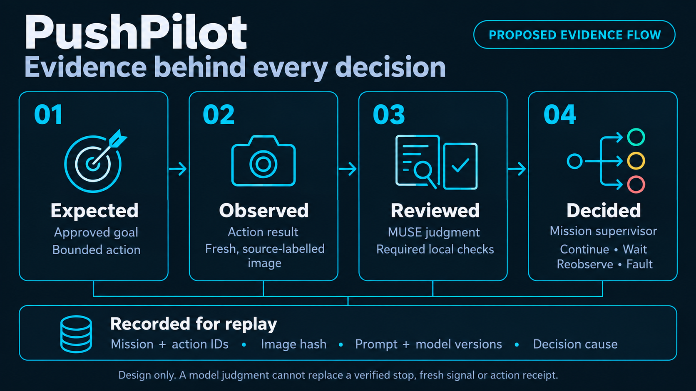

# Architecture

**A visible reasoning loop with explicit execution gates.**

[Documentation](README.md) · [Mission](MISSION.md) · [Meta intelligence](META_INTELLIGENCE.md) · [Roadmap](ROADMAP.md)

[Service composition](SERVICE_COMPOSITION.md) · [Voice input](VOICE_INPUT.md)

---

**Status: first simulation slice implemented; full image/voice architecture remains a design.** The running software consists of a React/TypeScript browser workspace and one FastAPI/Uvicorn backend with SQLite state, source-labelled events, an abstract simulator, and a strict-schema Meta goal adapter. Voice, image review, camera input, registered AR, and robot control remain unavailable. GX10 has been inspected read-only; this application has not been deployed there.

## System shape

*Design illustration created before the first runtime slice. Its voice/image flows and footer describe that earlier design stage; current implementation status is stated above and in the component text below. Select the image for the full-size view.*

The **tablet workspace** presents the goal, current state and approval. The **mission supervisor** combines source-labelled observations with goal interpretation and fresh-image MUSE review, then applies deterministic admission checks. Accepted bounded actions go to the abstract simulator first; a qualified robot adapter is a later integration. Action results feed new observations, while the evidence store connects the inputs, reviews and transitions back to the operator's timeline.

The planned **voice adapter** belongs inside the same backend. Its planned first implementation will accept a finite push-to-talk recording and call Meta's file transcription endpoint. It returns an editable draft transcript to the workspace. Only after the operator submits the text does it join the shared typed-goal interpretation path; the resulting plan still requires explicit tablet approval. The API key stays on the backend. [Voice input](VOICE_INPUT.md) defines cancellation, language and revision handling; [service composition](SERVICE_COMPOSITION.md) defines module and deployment ownership.

There are two complementary decisions: the model explains what the scene supports; the supervisor determines whether the complete set of required checks permits a state transition. An image-based judgment cannot manufacture a fresh signal, a verified stop or a hardware receipt.

## Responsibilities

| Component | Owns | Does not establish by itself |
|---|---|---|
| **Tablet workspace** | Goal entry, review, approval, scene evidence and replay | Permission to bypass backend gates |
| **Mission supervisor** | State transitions, action sequencing, waits, faults and admission | Physical motion capability without a qualified adapter |
| **Meta provider adapter** | Actual request/result handling, versions, timeouts and structured output validation | Authoritative robot coordinates or immediate stopping |
| **Voice adapter** | Bounded audio intake, server-side transcription, editable draft text and capture/session binding | Mission approval, raw robot commands or physical stopping |
| **Observation adapters** | Timestamped images, local signal observations and source identity | Metric accuracy without calibration and evaluation |
| **Action adapter** | One bounded action and its corresponding result | Successful vehicle displacement merely because a tool reached its target |
| **Evidence store** | Immutable inputs/results and their causal connection to decisions | A physical claim unsupported by the recorded sources |

The implemented action adapter is a hardware-free simulator with four symbolic action kinds: PUSH, STOP, CROSS, and VERIFY. `backend/app.py` validates revisioned commands with Pydantic, `backend/core.py` serializes transitions and records SQLite events, and `backend/meta.py` interprets goals through Meta. [`contracts/workspace.ts`](../contracts/workspace.ts) describes the frontend DTOs. Exact runtime dependencies are locked; [Development](DEVELOPMENT.md) documents startup. These source interfaces are not a full JSON Schema contract for future observations or voice.

Voice is planned initial-demo scope. Start with browser capture and one modular backend containing the voice adapter, MUSE adapter, mission supervisor, simulator and evidence modules. A separate speech server is not required by this design. Realtime transcription and speech playback are later options. No voice provider request or microphone path has been verified; the completed standalone Meta probe covers text only.

## Execution gates

The implemented simulator requires current-plan approval, review binding, and its simulated stop/signal gates. Reviews are operator-injected demo verdicts; they do not call MUSE. The full future observation-backed supervisor must check the applicable conditions together:

1. The operator has approved the current mission interpretation.
2. The preceding bounded action has a valid completion result and accepted review.
3. Required observations belong to the current action/session and meet freshness requirements.
4. Local checks and the MUSE review agree that continuation is supported.
5. At an intersection, stopping is verified and a fresh green observation permits admission.
6. The requested action belongs to the capabilities qualified for the selected action adapter.

Exact tolerances, freshness windows and physical action sizes are configuration and qualification work. They are not established by illustrative simulation settings.

### Signal handling has its own observation path

An operator changes a red/green paper signal. A local observation path must identify the relevant signal, retain timestamps and inhibit entry when it is red, absent, obscured or stale. MUSE receives scene context and reviews the stopped state; cloud response timing is not used as an immediate robot-stop mechanism.

Every configured approach requires a stop even on green. Once the qualified crossing has been admitted, it completes under its defined policy before the next approach. **Interrupting a moving robot when the paper changes color is outside the current scenario.** A web `HOLD` or server shutdown must never be presented as a physical emergency stop.

## Evidence that explains a decision

*Planned evidence flow. Every decision must retain its input sources and transition cause.*

The intended sequence is:

1. Record the operator goal and accepted interpretation.
2. Define the expected bounded action and its expected outcome.
3. Collect the action result and a fresh observation bundle.
4. Run local checks and retain the actual MUSE response and uncertainty.
5. Record the supervisor decision with its transition cause.
6. Continue with the next action, wait, request another observation or enter a fault state.

The current SQLite store retains workspace/plan/step/review identities, ordered source-labelled events, request digests, and original idempotent command receipts. Reusing a request ID with different content or submitting a stale revision is rejected. Reset retains event history. The Meta goal result is represented by its interpreted summary and source; the current store does not preserve a full raw provider receipt with usage, timing, or a prompt version.

The complete image-review design additionally requires source identity, capture time, immutable image hash/crop lineage, exact provider inputs/results, prompt/schema/model versions, timing, and validation outcome. Those media/review records are not implemented yet.

Robot state, image, vehicle pose, signal and model response retain **independent source labels**. Unknown values remain unknown. Unavailable provider cost is not reported as zero. Credentials must never appear in evidence, prompts, logs or release archives.

Raw payloads and provenance belong in expandable evidence views. The main workspace shows the information needed to understand the decision: expected versus observed outcome, concise grounded explanation and the next pending check.

## Failures and restart

| Condition | Intended behavior |
|---|---|
| Red, stale or unclear signal at an approach | Remain stopped; observe again |
| Obscured vehicle or insufficient image evidence | Request another observation; do not assume completion |
| Model timeout, malformed response or missing result | Preserve evidence and wait/reobserve according to bounded policy |
| Model and local check disagree | Block continuation and expose the disagreement |
| Action result is missing or ambiguous | Enter review/fault; do not automatically resend the action |
| Application restarts | Reconstruct history in a non-executing review state |

Old pending actions, old green observations and earlier crossing admission must not regain execution authority after restart. A code rollback changes the release, not the evidence history or pending command state.

## Map and physical integration boundary

Symbolic locations and abstract actions let the supervisor and UI run while the map is unresolved. No old map image or route is an application dependency. A user-provided temporary print can support explicitly labelled vision-input testing under [Test inputs](TEST_INPUTS.md); it does not finalize coordinates, signal regions, routes, or registration.

Later integration must establish the final road graph, installed camera/board/robot registration, stop and exit lines, signal regions, vehicle/tool geometry, pushing behavior and contact turning. A fixed gripped-car transform is not a model of surface pushing. Reusing a successful robot endpoint does not prove where an ungripped vehicle ended up.

## Delivery boundary

Development and testing take place in this repository. A clean committed source tree can be packaged with a commit/hash manifest using the release tools. That ZIP excludes ignored compiled frontend assets. The selected GX10 delivery uses a local frontend build and one Python runtime serving the bundle, with isolated release directories and shared SQLite state. Read-only inspection found ARM64 Ubuntu and Python 3.12.3, with no Node/npm on the inspected PATH; application installation and activation have not occurred.

See [development](DEVELOPMENT.md) for actual commands and [deployment](../deploy/README.md) for the proposed host separation. Packaging does not transfer files, start services or connect a robot.

---

[← Documentation](README.md) · [Next: mission behavior →](MISSION.md)
