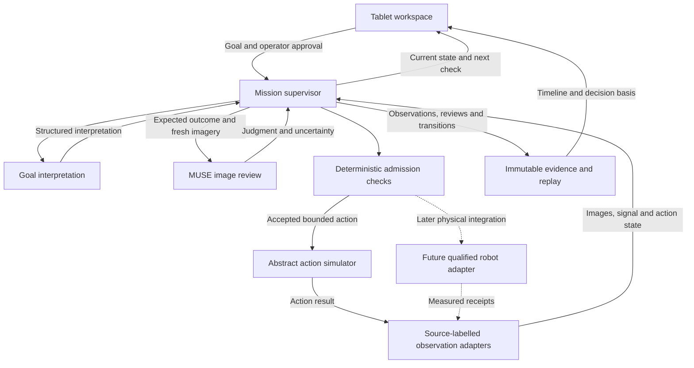

<div align="center">

# Architecture

**A visible reasoning loop with explicit execution gates.**

[Documentation](README.md) · [Mission](MISSION.md) · [Meta intelligence](META_INTELLIGENCE.md) · [Roadmap](ROADMAP.md)

</div>

---

**Status: proposed application architecture.** The repository implements bootstrap validation and release tooling. The diagram below describes the application to be built; it is not a diagram of a running deployment.

## System shape



There are two complementary decisions: the model explains what the scene supports; the supervisor determines whether the complete set of required checks permits a state transition. An image-based judgment cannot manufacture a fresh signal, a verified stop or a hardware receipt.

## Responsibilities

| Component | Owns | Does not establish by itself |
|---|---|---|
| **Tablet workspace** | Goal entry, review, approval, scene evidence and replay | Permission to bypass backend gates |
| **Mission supervisor** | State transitions, action sequencing, waits, faults and admission | Physical motion capability without a qualified adapter |
| **Meta provider adapter** | Actual request/result handling, versions, timeouts and structured output validation | Authoritative robot coordinates or immediate stopping |
| **Observation adapters** | Timestamped images, local signal observations and source identity | Metric accuracy without calibration and evaluation |
| **Action adapter** | One bounded action and its corresponding result | Successful vehicle displacement merely because a tool reached its target |
| **Evidence store** | Immutable inputs/results and their causal connection to decisions | A physical claim unsupported by the recorded sources |

The first action adapter will be a hardware-free simulator. Runtime frameworks, endpoints, event schemas and dependency locks will be selected with the implementation rather than implied by this design.

## Execution gates

Before issuing an action, the future supervisor checks the applicable conditions together:

1. The operator has approved the current mission interpretation.
2. The preceding bounded action has a valid completion result and accepted review.
3. Required observations belong to the current action/session and meet freshness requirements.
4. Local checks and the MUSE review agree that continuation is supported.
5. At an intersection, stopping is verified and a fresh green observation permits admission.
6. The requested action belongs to the capabilities qualified for the selected action adapter.

Exact tolerances, freshness windows and physical action sizes are configuration and qualification work. They are not established by illustrative simulation settings.

### Signal handling has its own observation path

An operator changes a red/green paper signal. A local observation path must identify the relevant signal, retain timestamps and inhibit entry when it is red, absent, obscured or stale. MUSE receives scene context and reviews the stopped state; cloud response timing is not used as an immediate robot-stop mechanism.

Every configured approach requires a stop even on green. Once the qualified crossing has been admitted, it completes under its defined policy before the next approach. **Interrupting a moving robot when the paper changes color is outside the current scenario.** A web `HOLD` or server shutdown must never be presented as a physical emergency stop.

## Evidence that explains a decision

The intended evidence chain is:

```text
Operator goal and accepted interpretation
  → expected bounded action
  → action result and fresh observation bundle
  → local checks and actual model response
  → supervisor decision with transition cause
  → next action, waiting state, reobservation or fault
```

Each link needs stable mission/action/review identifiers. An observation bundle records source identity, capture time, image hash and crop lineage; a review records provider/model, prompt and schema versions, request timing, response and validation outcome. The resulting state transition cites the records that caused it.

Robot state, image, vehicle pose, signal and model response retain **independent source labels**. Unknown values remain unknown. Unavailable provider cost is not reported as zero. Credentials must never appear in evidence, prompts, logs or release archives.

Raw payloads and provenance belong in expandable evidence views. The main workspace shows the information needed to understand the decision: expected versus observed outcome, concise grounded explanation and the next pending check.

## Failures and restart

| Condition | Intended behavior |
|---|---|
| Red, stale or unclear signal at an approach | Remain stopped; observe again |
| Obscured vehicle or insufficient image evidence | Request another observation; do not assume completion |
| Model timeout, malformed response or missing result | Preserve evidence and wait/reobserve according to bounded policy |
| Model and local check disagree | Block continuation and expose the disagreement |
| Action result is missing or ambiguous | Enter review/fault; do not automatically resend the action |
| Application restarts | Reconstruct history in a non-executing review state |

Old pending actions, old green observations and earlier crossing admission must not regain execution authority after restart. A code rollback changes the release, not the evidence history or pending command state.

## Map and physical integration boundary

Symbolic locations and abstract actions allow the supervisor, UI and review interfaces to be built while the map is unresolved. No old map image or route is required by the application bootstrap.

Later integration must establish the final road graph, installed camera/board/robot registration, stop and exit lines, signal regions, vehicle/tool geometry, pushing behavior and contact turning. A fixed gripped-car transform is not a model of surface pushing. Reusing a successful robot endpoint does not prove where an ungripped vehicle ended up.

## Delivery boundary

Development and testing take place in this repository. A clean committed source tree can be packaged with a commit/hash manifest using the implemented release tools. GX10 is the intended runtime host through an isolated release and shared-state layout; its directories and runtime have not been provisioned by this scaffold.

See [development](DEVELOPMENT.md) for actual commands and [deployment](../deploy/README.md) for the proposed host separation. Packaging does not transfer files, start services or connect a robot.

---

[← Documentation](README.md) · [Next: mission behavior →](MISSION.md)
