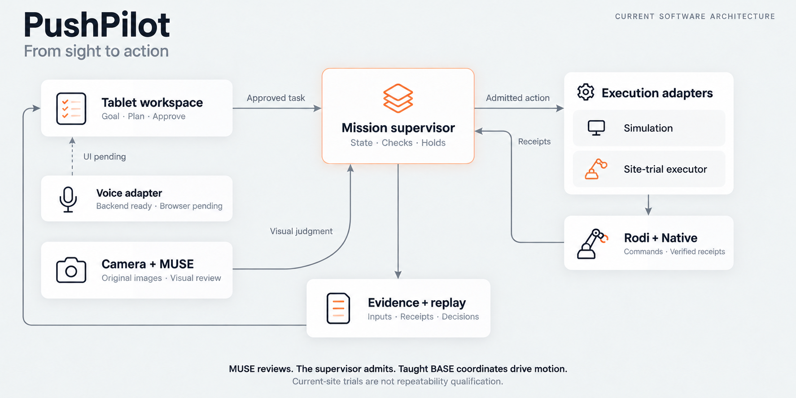
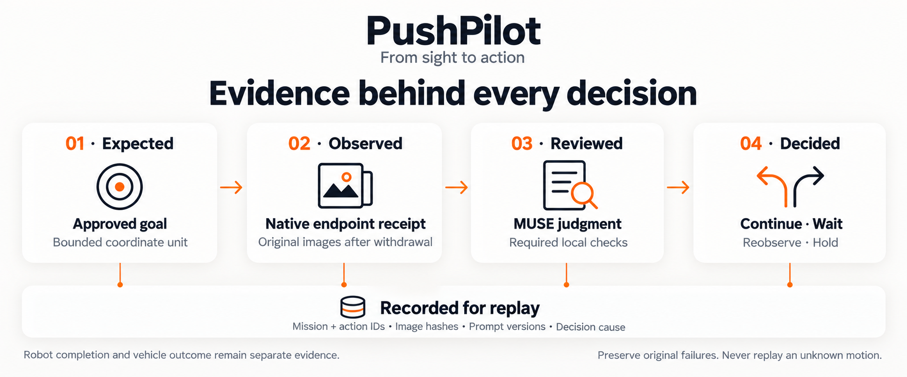

# Architecture

**From sight to action. A visible reasoning loop with explicit execution gates.**

[Documentation](README.md) · [Current status](CURRENT_STATUS.md) · [Mission](MISSION.md) · [Services](SERVICE_COMPOSITION.md)

---

PushPilot keeps its original **Observe → Plan → Approve → Act → Verify** loop. The current source has two execution branches: equipment-free simulation by default and an explicitly configured, current-site physical delivery trial. Both use an English tablet workspace, backend-owned state and inspectable evidence. Physical mode adds taught BASE motion, Native completion receipts, coordinate withdrawal/recontact and MUSE observation; it does not turn image pixels or a model answer into robot coordinates.

This page describes published source as of **November 2, 2026**. [Current status](CURRENT_STATUS.md) separates implementation, dated demonstrations and remaining qualification. The public repository excludes private route packets, controller runtime, profiles, operational images and model artwork.

## System shape

*Architecture illustration, not an application screenshot or evidence of a physical run. The earlier [voice-enabled design](assets/architecture-overview-voice.png) and [original architecture](assets/architecture-overview.png) remain unchanged design history.*

| Layer | Owns | Boundary |
|---|---|---|
| **Tablet workspace** | From/To preparation, source-labelled Camera/Spatial, plan review, explicit start/stop, sequence, signal and replay | A display status or Spatial car estimate cannot authorize movement. Browser voice capture is still pending. |
| **One application backend** | FastAPI API, compiled frontend, revisioned simulation workspace, physical coordinator, provider adapters and evidence | One worker; physical and simulation state have separate identities/revisions. |
| **Simulation branch** | Graph-derived PUSH/STOP/CROSS/VERIFY, simulated receipts and deliberate demo/live/recorded review | A real image does not change a simulated receipt into hardware completion. |
| **Physical branch** | `PhysicalMissionService`, `SiteTrialMissionDriver`, taught B/C/D recipes, Native-bound checks, observation and empty START return | Opt-in current-site trial, not a general planner or repeatability-qualified robot product. |
| **Commissioning API and Rodi host** | Profile/command validation, persistent pendant receiver, exact-source dispatch and controller completion/Native evidence | Separate process lifetime and server-held token. Unknown movement is never automatically replayed. |
| **Native camera helper** | Independent device ownership and original JPEG transport | Preview polling does not persist every image, invoke MUSE or own robot control. |
| **MUSE** | Map-scoped route interpretation, qualitative action/arrival review and stopped paper-signal judgment | Returns structured observations; no executable script, authoritative TCP target or plan approval. |
| **Evidence and display collector** | Private journals/original selections, causal decisions and a GET-only physical display cache | Confirmed receipts drive display estimates; display failures cannot dispatch or stop a robot. |

`backend/maps.py` validates the exact selected directed node sequence, including departure, first-turn, ordered-via and avoid constraints. It derives Camera/Spatial route geometry from the selected drawing. In Robot mode, the operator reviews the current live MUSE plan in PLAN_READY and chooses **Start robot mission** as the explicit approval/start action; the driver selects its matching reviewed private recipe. Simulation `/approve` is a separate flow. The driver does not execute the graph polyline as a Cartesian trajectory.

The configured City drawing is `seoul-city-a3`, version `2026-10-28.4`: Pizza starts in front of the building; B/Office Building is the direct frontage route, C/Villa and D/Hanok use their frontage routes through the central approach. The source-default Little Town adapter remains a compatibility fixture. [Map replacement](MAP_REPLACEMENT.md) explains why changing a print or drawing does not recalibrate BASE motion.

## Meta MUSE: the intelligence inside the loop

MUSE connects operator intent and visible evidence to the next supervised decision. It interprets the goal, reasons over the selected graph, judges the controlling paper signal while stopped and reviews action/arrival evidence. Its outputs are more than presentation: accepted, rejected or uncertain judgments affect whether the supervisor plans, continues, waits or holds. The execution layer supplies taught coordinates and measured command receipts; it does not ask the model to invent TCP targets. [Meta intelligence](META_INTELLIGENCE.md) presents the [intelligence illustration](assets/muse-intelligence-current.png), current prompts and original outcome records.

## One loop, two execution branches

| Phase | Equipment-free simulation | Configured physical site trial |
|---|---|---|
| **Observe** | Explicit demo, recorded images or deliberate native selections | Fresh source-bound Native state, installed camera reference and car/signal observations |
| **Plan** | MUSE-selected or explicit demo graph route | Approved destination matched to a hash-bound taught recipe and current installation |
| **Approve** | Current workspace plan/revision | Same-origin physical start also binds physical revision, workspace session, plan, map and route |
| **Act** | One abstract simulated receipt | Known-source low-speed Linear/contact/clearance stages with original limits and guarded unloaded wrist operations |
| **Verify** | Bound review and simulated junction gates | Native completion and applicable MUSE review; the tool reaching an endpoint alone is not car arrival |

The active physical release is **delivery_only**. B/Office, C/Villa and D/Hanok recipes exist. C ends at **C-step-26**, with a destination/zone arrival check and empty-tool START return; numeric straightening and parallel parking are deferred. Historical physical arrivals are recorded in the [measured route catalogue](MEASURED_ROUTE_CATALOGUE.md). They are not evidence that every later recipe or reset is repeatable without intervention.

## Visibility and the single signal departure

Contact motion uses taught coordinates. At review points the tool releases normally and withdraws to a reviewed observation pose. The controlled northbound approach uses the far-RIGHT wait so the car and paper signal can be seen; car-only review may use an applicable reviewed LEFT/RIGHT pose. Clearance is a measured motion, not an image-generated recovery command.

For the current `single_departure` policy: stop and withdraw → obtain accepted stopped GREEN → measured recontact → admitted continuation. There is **no second color wait after recontact**, and a later color change does not revoke this departure. A new mission needs a new admission. Two increasing-time source images support the paper-signal review; the black circular paddle/cable tie is expected. Clearly covered red plus visible green can support GREEN, while both colors substantially exposed, an uncertain cover or a moving mask remain WAIT. Native/session/stop guards remain active. See [single signal departure](SINGLE_SIGNAL_DEPARTURE.md).

Physical observation uses `pushpilot.physical-observation.v4`; live graph planning uses `pushpilot.live-route.prompt.v3`. The C intermediate policy uses qualitative progress, C4/C6 same-coordinate detail crops, C14's explicitly wider same-mission reference interval and qualitative C17. The configured C19 omission records an operator omission, not a synthetic PASS. `clear_problem: null` stays unknown; the narrow intermediate rule does not stop for that field alone when visible progress and the other checks pass. Start, signal and final arrival remain independent. See [prompt catalogue](../prompts/README.md).

## Display and evidence remain separate

*Current evidence illustration. The [original evidence-loop design](assets/evidence-loop.png) is retained as history.*

Live preview retains a bounded eight-frame RAM cache; explicit model operations preserve selected originals separately. The browser shares exact original JPEG bytes through a Blob URL lifecycle with a 250 ms request target; that target is not measured frame rate or exposure latency. Repeated frames keep aging. A stale/changed display can withhold AR without inventing a replacement image or robot position.

Board-to-image display registration, nominal drawing geometry, the Spatial model fit and taught BASE execution are four distinct relationships. Temporary marker occlusion does not refit the locked display. The Spatial vehicle is labelled **Execution estimate / Display only**, driven by confirmed executor receipts; it is not measured car tracking. See [Camera](LIVE_CAMERA.md), [Spatial](SPATIAL_3D.md) and [route display](ROUTE_DISPLAY.md).

Workspace SQLite, selected-frame evidence, physical coordinator records and receiver journals retain their own session/request/command identities. Original FAIL/UNKNOWN results and interrupted requests are preserved through reset and explicit continuation. Unknown values, unavailable cost and unmeasured car travel stay unknown. Raw photos, route coordinates and secrets remain private.

## Recovery and remaining limits

A process restart never automatically resumes a worker, replays movement or restores old GREEN authority. Explicit review continuation, C11 boundary preparation and session-scoped START precision binding are narrow operations with different preconditions. Reset retires the old mission; it is not a robot return command. [Robot operations](ROBOT_OPERATIONS.md) is the operational decision guide.

Intermittent Native-read timeouts can still close the Rodi connection while idle. Separating connection heartbeat from blocking reads and adding bounded read-only recovery was analyzed but **has not been implemented**. A web HOLD is not a hardware emergency stop. Simulation watch, provider timeout, receiver freshness, wrist completion and physical signal budgets are separate clocks; no public-source claim here verifies the requested physical 120-second signal wait.

Measured vehicle pose, robust slip correction, parallel parking, unattended repeatability, tablet microphone/HTTPS and full calibration qualification remain open. [Known limitations](KNOWN_LIMITATIONS.md), [verification](VERIFICATION.md) and the [evidence index](evidence/README.md) retain their exact scope.

---

[Mission →](MISSION.md) · [Development](DEVELOPMENT.md) · [Deployment](../deploy/README.md)
