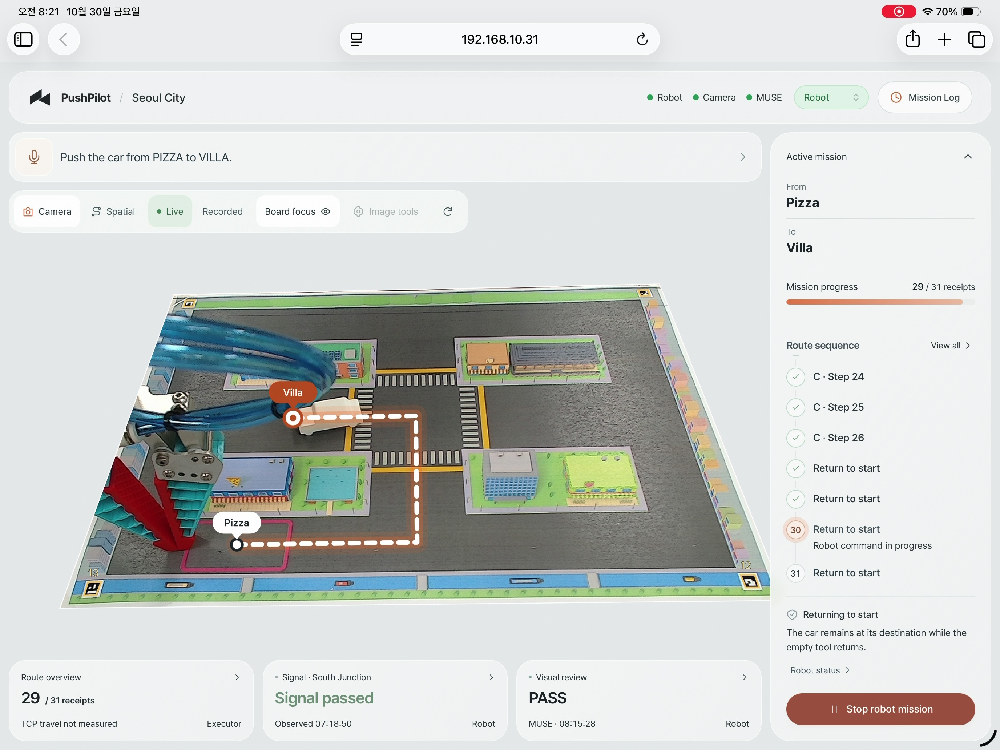
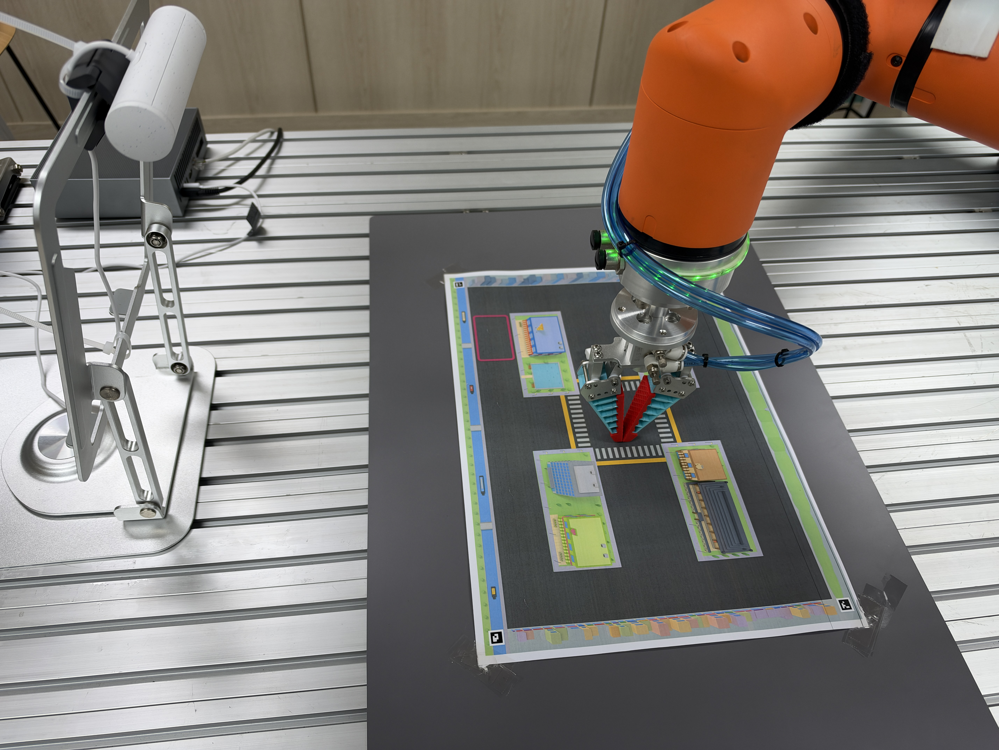
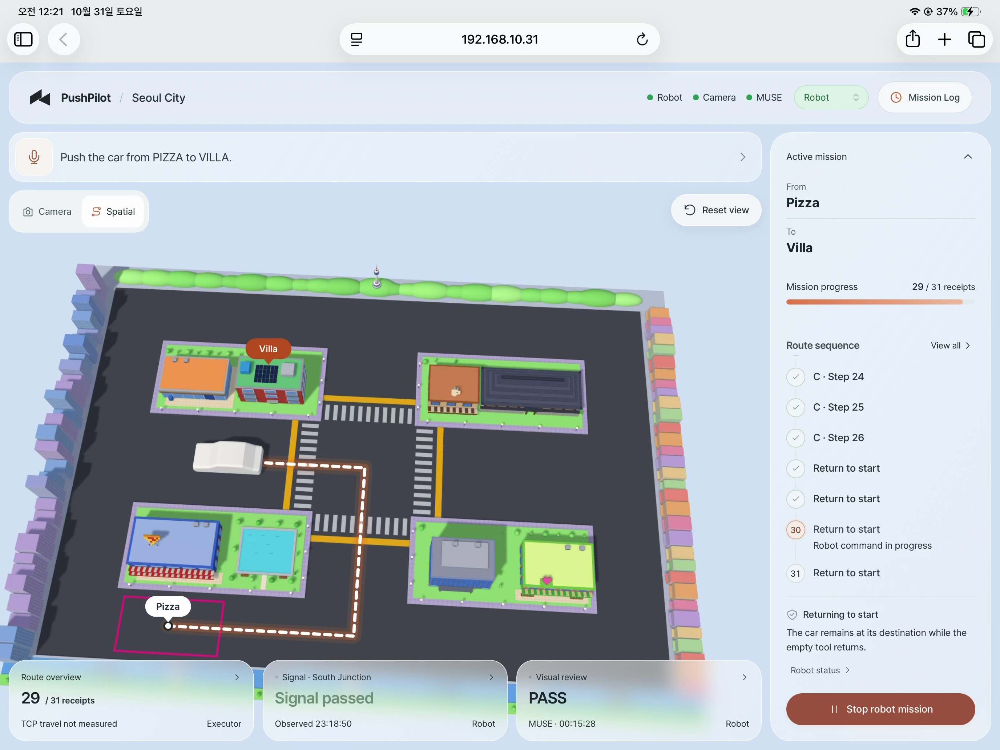
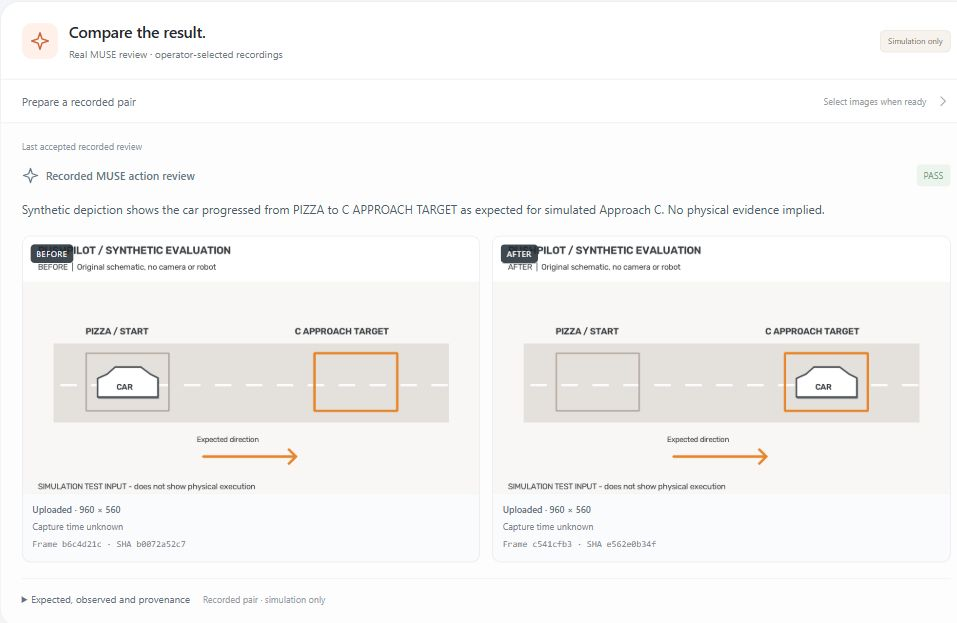

# See the judgment behind the action

**PushPilot · From sight to action**

A robot can finish a motion without finishing the task. PushPilot pairs a shared AR plan and taught-coordinate execution with **Meta MUSE's interpretation of the visible outcome**. The supervisor records whether that evidence supports continuing, stopping or taking another look.

[Project overview](../README.md) · [Current capabilities](CURRENT_STATUS.md) · [Meta MUSE's role](META_INTELLIGENCE.md) · [Evidence archive](evidence/README.md)

## Watch the physical recordings

The user supplied the following tablet recordings and setup photograph from the demonstration archive. These are actual captures, separate from the synthetic review cases below.

| Watch | What is visible | Scope |
|---|---|---|
| [Camera · Villa and empty-tool return](https://drive.google.com/file/d/1Hflx4wuoLFTQvOuHA_Aqk8_FBQhNt1bp/view) · about 2:19 | Actual robot/car, AR route, return receipts and the last recorded MUSE PASS. | The clip begins after arrival, with return already in progress. It does not show the full delivery or new inference during return. |
| [Spatial · route and sequence](https://drive.google.com/file/d/1ZxNHMMrLSJfVC78_qcFdsB_DVkqEp-f3/view) · about 2:14 | Actual rendered application view, selected route and sequence-details dialog during return. | The rendered car is an execution estimate, not measured vehicle tracking. No synchronization with the separate Camera recording is claimed. |

*Click the image for the Camera recording. Source-video clocks differ; filenames are not used to assert cross-recording timing. [Source/extraction record](assets/PHYSICAL_MEDIA.md)*

<strong>Actual setup and Spatial view</strong>

*Actual setup photograph; it does not establish a completed mission.*

*Actual application capture of the rendered Spatial view. Click to watch.*

## Explore three recorded decisions

**[Explore 3 recorded Muse decisions →](https://jominsu-ku.github.io/PushPilot/)**

The public read-only explorer puts **the actual input pair, original MUSE judgment and resulting simulated supervisor state** on one page. Open the link, then select **Progress visible**, **No progress** or **View occluded**. Expand provenance to inspect hashes and the full public record. No download, account, equipment or API key is needed, and no new inference occurs.

For offline use, download/extract or clone this repository and open [`docs/review/index.html`](review/index.html) directly in a browser. The Markdown table below remains an immediate GitHub preview. [Hosting scope and reproduction](REVIEW_HOSTING.md)

| Designed input condition | Original Meta MUSE judgment | Recorded supervisor state | What the example makes visible |
|---|---|---|---|
| The depicted car reaches the target | `PASS` | `READY` | The supplied pair supports the expected depicted progress. |
| The depicted car stays at the start | `FAIL` | `FAULT` | A completed simulated action does not make an unchanged car a success. |
| A foreground occluder hides the relevant area | `REOBSERVE` | `REOBSERVE` | Missing visual evidence remains a request for another observation. |

These are **three actual provider requests on original synthetic schematics**, recorded on October 27, 2026: one designed case per condition. They changed isolated simulated missions. They are not photographs, live inference, a recognition-accuracy benchmark or proof of physical success. The review creates **no physical motion authority**. Full results, wording, timings, token counts and immutable input hashes are preserved in the [public JSON](evidence/synthetic-action-reviews-20261027.json); the [integration record](META_API_CHECK.md#actual-action-review-requests-on-synthetic-inputs) explains the request boundary.

*Actual archived application panel, with synthetic review inputs. This separate browser check is described in the integration record; it is not a physical robot image.*

## Read the physical evidence

The [measured route catalogue](MEASURED_ROUTE_CATALOGUE.md) preserves historical B/C/D trajectories. The [current site-trial guide](DELIVERY_SITE_TRIAL.md) describes the later delivery-only implementation. These are separate from the synthetic review cases above.

| Destination from Pizza | Historical arrival evidence | Empty-tool return evidence | Scope to keep in mind |
|---|---|---|---|
| **B · Office Building** | Completed contact motions and a separate original MUSE arrival judgment | Completed translations to the original literal START pose | A recorded arrival and return do not establish unattended repeatability. |
| **C · Villa** | Operator-accepted arrival; the original trajectory includes observations, operator decisions and receiver recovery | Completed translations and directed unloaded wrist edges restored START XY and the EAST face | This historical C trajectory is not a demonstration of uninterrupted autonomy. The later active delivery recipe ends at [C26](C26_DELIVERY_ENDPOINT.md). |
| **D · Hanok** | Original MUSE arrival judgment after the clean START reset | A derived return corridor includes an unexecuted reverse transition | Do not describe the derived final-D return as physically verified. |

Arrival, robot endpoint completion and return are distinct records. The current delivery-first scope does not guarantee final parallel parking or numeric vehicle alignment. Hardware trials depend on the private installation, reviewed geometry and current source state. [Known limitations](KNOWN_LIMITATIONS.md)

## Follow the decision, then inspect the implementation

| Question | Inspect |
|---|---|
| What does Meta MUSE contribute? | [Goal understanding, route reasoning, signal judgment and visual review](META_INTELLIGENCE.md) |
| How does the application distinguish a plan from permission to move? | [Architecture](ARCHITECTURE.md) and [mission contract](MISSION.md) |
| How does one GREEN admission connect to a crossing? | [Single signal departure](SINGLE_SIGNAL_DEPARTURE.md) |
| How are review exceptions made explicit? | [Current C review matrix](C_INTERMEDIATE_PROGRESS_REVIEW.md#current-c-review-matrix) |
| What happens after a failed or interrupted action? | [Robot operations](ROBOT_OPERATIONS.md) and [explicit review continuation](EXPLICIT_REVIEW_CONTINUATION.md) |
| Where are the dated results and unresolved checks? | [Public evidence index](evidence/README.md) and [known limitations](KNOWN_LIMITATIONS.md) |

The read-only explorer makes no API or hardware requests. Its synthetic input PNGs are byte-identical regenerations from the original [fixture generator](../tools/action_review_fixtures.py), verified against every hash in the public record. The provider results are reproduced unchanged; selecting a case only changes which archived case is displayed.
