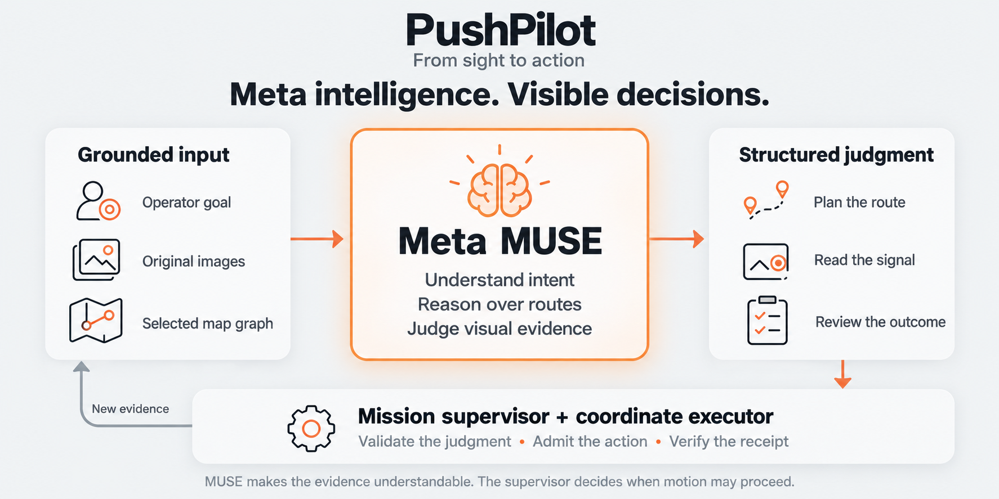

# Meta intelligence

**Interpret intent. Compare the evidence. Make the consequence visible.**

[Documentation](README.md) · [Architecture](ARCHITECTURE.md) · [Mission](MISSION.md) · [Prompts](../prompts/README.md)

---

PushPilot uses backend-originated MUSE requests for map-scoped goal/route interpretation, independent scene inspection, action review and stopped paper-signal judgment. Structured outputs describe meaning and visible evidence. The supervisor owns the decision to continue, wait, reobserve or hold. **MUSE never supplies authoritative TCP coordinates or executable robot scripts.**

As of **November 2, 2026**, simulation and the configured physical site trial have separate review pipelines. [Current status](CURRENT_STATUS.md) and [API evidence](META_API_CHECK.md) distinguish implemented contracts, dated provider observations and incomplete recognition/repeatability evaluation.

## Meta MUSE connects the loop

*Conceptual illustration of implemented intelligence boundaries, not a screenshot, provider result or physical success record.*

Meta MUSE is the semantic intelligence in **From sight to action**: it turns a request into map-grounded intent, reasons over connected roads, reads the controlling paper signal while stopped and compares visible action/arrival evidence. Its contribution is visible in the next decision, including clarification, waiting and rejection. The execution layer carries out admitted taught motion and records what actually completed; MUSE then interprets what the camera can support. Keeping those roles explicit makes the reasoning inspectable without claiming that the model directly controls TCP motion or guarantees the car's outcome.

## Current model boundaries

| Boundary | Model input/output | Application consequence |
|---|---|---|
| **Symbolic goal** | Selected map's allowed destinations/aliases and user text → destination/clarification | Reviewable deterministic graph plan; no automatic approval |
| **Live route, prompt v3** | Accepted goal, original JPEG, selected directed graph and constraints → exact node path | Backend validates departure/turn/via/avoid and derives drawing AR; no graph-to-TCP conversion |
| **Recorded scene** | Immutable uploaded image → USABLE/REOBSERVE/UNKNOWN, places, car/signal evidence | Independent inspection, never step completion or GREEN authority |
| **Recorded/live simulation action** | Bound BEFORE/AFTER and abstract receipt → PASS/FAIL/REOBSERVE/UNKNOWN | Applies only to the pending simulated review |
| **Physical observation v4** | Source-bound car/start/arrival context and originals → PASS/FAIL/UNCERTAIN plus structured facts | Combined with Native/session/profile/freshness checks for the configured site trial |
| **C intermediate progress v2** | Native side-by-side comparison and scoped details → progress/no progress/uncertain/clear problem | Qualitative continuation criterion only for opted-in intermediate C reviews |
| **Stopped physical signal** | Stopped reference and two distinct ordered samples of the configured target | Exclusive visible/covered-face evidence can support a one-time stopped departure admission |
| **Voice transcription** | Finite supported PCM WAV → original-language candidate | Backend implemented; browser capture/editor and actual ASR access/device checks pending |

Allowed place identities come from the selected map. City uses Pizza, Office Building, Villa and Hanok; Bakery/Bookstore/School remain Little Town compatibility vocabulary, not hard-coded production goals.

## Physical progress without invented precision

Contact motion is coordinate based. The tool releases and moves to a reviewed observation pose before applicable visual review. A robot endpoint proves tool completion only; a visible change or arrival is assessed separately. The active delivery-only release does not claim numeric vehicle pose, exact turning angle or parallel parking.

| C review scope | Implemented policy |
|---|---|
| **C4/C6** | Same-coordinate detail crops accompany full originals; crop lineage/hashes remain explicit. Earlier false negatives/timeouts are preserved. |
| **C14** | Optional clear C13 GREEN reference spans exactly recontact plus C14 with same-mission/session/camera lineage. It does not attribute all movement exclusively to C14. |
| **C17** | Qualitative visible translation/rotation, without exact angle, compass heading or front/rear demand. |
| **C19** | Explicit configured omission/checked continuation; retain original NO_PROGRESS and record omission, never fabricate PASS or replay C19. |
| **C26 arrival** | Visible car in the selected Villa frontage road/zone; parallel posture is not required. Unconfirmed arrival reobserves/holds rather than entering numeric correction. |

`clear_problem: null` remains an unknown field in the original result. In the opted-in intermediate policy alone it does not stop visibly supported progress when the car is visible/unobscured and Native/context/freshness checks pass. Explicit problems, uncertain movement, occlusion and failed signal/start/arrival requirements remain independent blockers. A later review is not guaranteed to catch an earlier missed problem.

[C intermediate review](C_INTERMEDIATE_PROGRESS_REVIEW.md), [explicit continuation](EXPLICIT_REVIEW_CONTINUATION.md) and [C26 delivery](C26_DELIVERY_ENDPOINT.md) retain the exact limits and original failed outcomes.

## Manual paper signal

The paper target permanently has red and green faces. The operator covers one with a black circular paddle on a cable tie. MUSE checks the configured physical target rather than traffic-light decoration or an expected color. Positive covered-red evidence plus visible green is needed; absence of red alone cannot mean GREEN. A narrow exposed rim/small tremor is allowed when coverage is otherwise clear. Broad exposure, both/none, uncertain placement or substantial mask movement remain UNKNOWN/WAIT.

The current `single_departure` policy accepts one stopped GREEN, performs measured recontact and continues without another color wait. Two distinct increasing-time samples, car continuity and current stop/Native/request bindings still matter. A new mission needs new admission. The provider supplies color judgment; deterministic checks supply applicability. Later color changes do not revoke an already admitted crossing. See [single signal departure](SINGLE_SIGNAL_DEPARTURE.md).

## Traceable consequence

1. Pin the applicable mission/action/step and original observation identities.
2. Record the exact model/prompt/schema and expected visible outcome.
3. Dispatch only the intended bounded request; a failed request never becomes a demo fallback.
4. Validate schema, source, time and current context after inference.
5. Retain the original result, limitations and decision cause.
6. Continue, wait, reobserve or hold without resending a completed movement.

Private evidence retains original JPEGs, hashes, command/Native lineage and scoped crops where implemented. Unknown usage/cost stays unknown. A display estimate, USABLE scene or recorded PASS cannot create physical authority. Provider cancellation may not cancel work already accepted upstream; late results must remain locally ineligible.

## Evidence and evaluation

The October 27 integration records include text planning, one recorded Little Town inspection and three original synthetic action pairs with PASS/FAIL/REOBSERVE consequences. These remain dated integration examples, not the current physical accuracy claim. Later physical and archived-image review summaries are linked from [API evidence](META_API_CHECK.md) and the [evidence index](evidence/README.md). Original FAIL/UNKNOWN/timeouts and rejected prompt variants are preserved.

### Actual robot completion, rejected task outcome

The public [D extended-contact record](evidence/taught-D-extended-contact-20261029.json) contains **11 actual motion stages with every Native endpoint verified**, while the original whole-unit MUSE result is **FAIL**, `arrived: false`, and `car_footprint: OVERLAPS_ISLAND`. Its two contact TCP segments total 39.8 mm; that is tool travel, not measured vehicle displacement. The provider receipt and original input-image hashes remain in the record. A subsequent operator-directed clean START reset is recorded separately from the rejected contact result.

This is a concrete reason to separate controller completion from visual task review. It does not establish that every MUSE judgment is correct, nor does it turn the historical operator-directed experiment into an autonomous mission.

### Published real-image failure analysis

The [existing October 30 C review summary](C_INTERMEDIATE_PROGRESS_REVIEW.md#archived-evaluation-2026-10-30) reports archived actual-camera input evaluations using Muse Spark 1.3, minimal reasoning and a 2,200-completion-token ceiling. The initial replay used **124 API calls covering 168 observations**: 71 intermediate comparisons, six fixed-start checks, 44 signal pairs containing 88 samples, and three C26 arrival checks. These are distinct units, not 168 independent API calls or an accuracy denominator.

| Published evaluation scope | Observed result / failure | Scoped response and remaining limit |
| --- | --- | --- |
| Initial 71 intermediate comparisons | Model outputs: 66 progress, three no-progress, two uncertain. Manual C4/C6 inspection found visible motion missed by the model; C14's uncertain BEFORE views hid the car. | C4/C6 identical-coordinate detail crops; C14's explicitly wider clear-reference interval. Neither establishes reliable detection in every frame. |
| Separate 12-case C4/C6 detail experiment | Eleven final judgments indicated progress. One case timed out, then returned no-progress on an explicitly recorded retry despite visible movement. | Preserve the timeout and false negative; do not turn the 11 outputs into a general accuracy percentage. |
| Final signal-detail replay: 44 pairs / 88 sample judgments | 18 GREEN, four RED, 66 UNKNOWN; no HTTP/schema errors in this replay. An earlier candidate incorrectly called moving-mask case 082 GREEN. | Same-source signal details made case 082 UNKNOWN in the focused follow-up; its two API timeouts remain separate failures. Two ordered samples and stop/source gates still apply. |

The source summary preserves rejected prompt variants, focused follow-ups and later re-evaluations separately. These selected archived inputs were not an independently labelled held-out benchmark. No raw private images, offline comparison files or new evaluations are added here, and their output distributions must not be pooled into a success rate.

Software checks verify contracts and rejection behavior. General accuracy requires independently labelled held-out inputs, matched success/no-progress/occlusion cases, false-continuation and uncertainty rates, latency and reported usage. Historical arrivals do not establish repeatable unattended delivery on a later recipe or installation. No new provider request was made for this documentation refresh.

Keep credentials, operational photos and private geometry outside Git, prompts and public logs. The finite voice backend uses the server-held credential; it does not establish ASR access or microphone support. [Voice backend](VOICE_BACKEND.md), [contributions](../CONTRIBUTIONS.md) and [third-party notices](../THIRD_PARTY_NOTICES.md) retain implementation/provenance boundaries.

---

[Prompt catalogue](../prompts/README.md) · [Live intelligence](LIVE_INTELLIGENCE.md) · [Verification](VERIFICATION.md)
