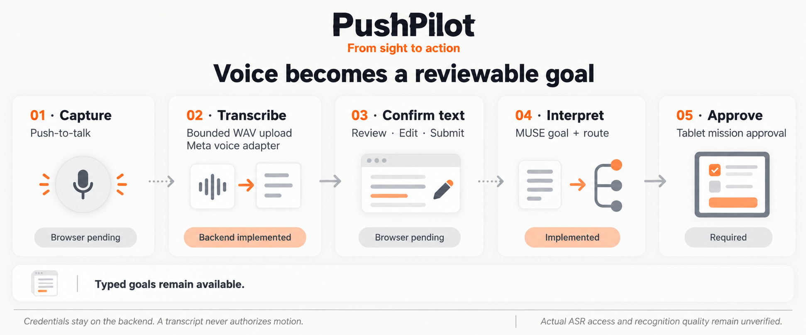

# Voice input

**Say the goal. Check the words. Review the plan.**

[Documentation](README.md) · [Voice backend](VOICE_BACKEND.md) · [Live intelligence](LIVE_INTELLIGENCE.md) · [Services](SERVICE_COMPOSITION.md)

---

**Status, November 4, 2026: browser capture, waveform/loading states and transcript editing are implemented against the finite-upload backend. Actual iPad microphone behavior and Meta voice access are not verified.** The browser records bounded mono PCM WAV, and the backend returns an original-language, workspace/map-bound transcript candidate. The operator reviews or edits it and explicitly chooses **Create a plan**. The resulting plan still requires the existing separate approval. Software tests and historical Spark checks do not establish voice access or recognition quality. See the [exact upload/candidate contract](VOICE_BACKEND.md).

The November 4 release `20261104-ipad-voice-d293dfd` is activated, including LAN-only Caddy 2.11.8 HTTPS on port 8443. The operator confirmed iPad certificate installation, full SSL trust and warning-free HTTPS access. That establishes the transport prerequisite, not a successful microphone recording or ASR call. Six served assets matched their hashes/MIME responses; the activation also preserved COMPLETE 31/31 and denied a voice probe before provider dispatch without resetting or moving the robot. No camera was started and original-JPEG comparison remains unperformed. See the [deployment and verification record](IPAD_VOICE_INPUT.md).

## Visible goal and voice entry

The current workspace uses compact glass **From / To** preparation controls and a goal dialog. The accepted goal remains distinct from an unsent editor draft; its source is **Typed** or **Voice** from `goal.source`. The current plan can be inspected during execution while goal editing remains restricted to preparation. See [Current status](CURRENT_STATUS.md) and [Design system](DESIGN_SYSTEM.md) for the active layout.

In eligible preparation, the microphone starts a finite recording on the first tap and finishes it on the second; recording also stops automatically at 20 seconds. During speech, the orange bars follow a rolling history of actual microphone RMS. During permission/transcription the goal bar shows an indeterminate spinner. The returned text appears in the bar and opens an editable transcript in **Voice input**. **Type instead** preserves the existing text/MUSE workflow. No waveform, loading state or transcript supplies plan approval.

## The first voice experience

*Historical November 2 illustration, not evidence of current microphone connection or an executed mission. Browser capture/editing were implemented on November 4; target-device/provider checks remain outstanding. The [original planned-only voice diagram](assets/voice-input-flow.png) is also retained as dated design history.*

The implementation uses a **finite tap-to-start/tap-to-finish recording**, sent through the provider's `PUSH_TO_TALK` mode. The operator receives a transcript, corrects it when necessary and chooses **Create a plan**. Only that explicit action submits the confirmed words for MUSE goal interpretation. The resulting plan still needs explicit tablet approval before the mission supervisor may admit an action.

| Stage | Operator sees | Application responsibility |
|---|---|---|
| **Record** | Orange microphone, volume bars and `Finish recording` | First tap requests permission; second tap or the 20-second limit ends recording; allow cancellation |
| **Transcribe** | Spinner, `Recognizing speech…` and a cancel action | Release the microphone, upload finite WAV through the backend and retain capture identity |
| **Check words** | Editable transcript, `Record again` and `Create a plan` | Preserve the original transcription separately from operator edits; submit only confirmed text |
| **Interpret** | Structured goal and any clarification needed | Submit only the explicitly accepted transcript revision to Spark |
| **Review plan** | Proposed behavior, evidence and the existing mode-specific approval | Bind approval to the current mission interpretation and plan revision; speech never approves it |
| **Act and verify** | Current action, checks and review outcome | Apply the same deterministic gates used for typed goals |

Typing remains available whenever goal entry is allowed. A microphone denial, unavailable audio device or provider failure must leave a useful text-entry path in that goal-entry state.

### Input eligibility and device setup

New typed or spoken goals belong to non-executing preparation. Simulation APIs reject goal replacement outside workspace preparation, and the tablet disables editing while a Robot mission is active, including RED waiting, observation review and crossing. The November 4 voice-only server guard additionally checks the physical coordinator before/after transcription, on candidate lookup and before accepting `source: "voice"` through either goal route. Active/HOLD/unknown states, busy or unavailable local proof, an active worker, unresolved error or any unretired mission ID reject spoken intent. A completed physical mission must follow the existing reset/retirement procedure first. An absent/default disabled coordinator or READY with no mission/error remains eligible. Typed/live goal API paths retain the prior cross-service limitation; this change is not a global replacement lock. Cancelling voice input does not terminate or stop a mission.

Before recording, the browser checks `isSecureContext`, backend configuration and microphone API/device availability. The tablet needs HTTPS trusted by that device; a plain HTTP LAN address is not the local-development `localhost` exception. The LAN HTTPS endpoint is activated and iPad trust/access were operator-confirmed on November 4; actual microphone permission/capture and ASR still need separate checks. [`deploy/ipad-https`](../deploy/ipad-https/README.md) remains candidate/example provisioning documentation, while the [activation record](IPAD_VOICE_INPUT.md) describes the actual installation. It does not make the existing HTTP address microphone-ready. Permission denial, an unavailable device or an unsuitable origin shows an actionable English status and preserves eligible text entry. See [browser microphone requirements](https://developer.mozilla.org/en-US/docs/Web/API/MediaDevices/getUserMedia).

### Language and display

All interface controls, accessibility labels, errors and developer-authored text are English. The operator may speak Korean or English. The raw utterance and returned transcript are user data: preserve their original language and do not label an English rewrite as the original transcript.

An accepted Korean transcript may be interpreted into the application's English goal summary and symbolic destination. Show that interpretation as a separate result for review. Ambiguous locations require clarification; no map coordinates are inferred from speech.

## Provider boundary

The implemented backend adapter targets **Meta Muse Voice Transcribe**, model `muse-voice-transcribe-1.0`, whose documentation lists Korean and English. This is not a claim of verified account access or language accuracy. The finite-recording path uses the documented authenticated HTTP API; streaming remains deferred. The dedicated voice model is preferred over Spark 1.3 audio understanding, whose documented support has limitations. See [Meta speech-to-text](https://dev.meta.ai/docs/speech-to-text) and [Spark audio limitations](https://dev.meta.ai/docs/video-understanding).

| Boundary | Current implementation / remaining UI | Later option |
|---|---|---|
| Browser → application | Bounded Web Audio capture, mono 16 kHz PCM16 WAV encoder and multipart upload; actual iPad verification pending | Browser audio chunks to the application |
| Application → Meta | `POST /v1/asr/transcribe`, Bearer authentication | `/v1/asr/realtime` WebSocket with the documented authentication handshake |
| Accepted text → goal understanding | Explicit transcript receipt plus confirmed text through native-frame/graph MUSE planning | Same approval boundary |

The `/v1/asr/...` paths in this table are **provider paths**. PushPilot implements `POST /api/v1/voice/transcriptions` and separate candidate/status endpoints described in [Voice backend](VOICE_BACKEND.md). The future Meta real-time WebSocket uses its documented handshake authentication; an `Authorization` header is ignored for that path. Server credentials must never be placed in the browser or proxied to it as a usable provider token.

The backend requires RIFF/WAVE containing mono 16-bit integer PCM at 16 or 24 kHz, 0.2–20 seconds and at most 1 MiB. It validates container/sample bounds and rebuilds the WAV header without ancillary metadata while preserving samples. It does not decode WebM/Opus, MP4/AAC, MP3, stereo or other rates and does not resample. The browser's AudioWorklet path, with ScriptProcessor fallback, mixes channels to mono and uses bounded fractional-bin averaging to resample the actual device rate to 16 kHz before WAV encoding. Unsupported uploaded formats still fail before dispatch. The volume bars use measured RMS rather than synthetic movement or confidence. See [file transcription requirements](https://dev.meta.ai/docs/speech-to-text).

Use the existing backend-only `META_API_KEY` from the ignored repository-local `.env` during development. Do not expose it through frontend build variables, browser storage, URLs, transcripts, prompts, logs or replay. A real transcription call must separately establish that the key has voice access; a successful Spark call is insufficient.

Configure a fixed approved provider origin and require TLS. Credential-bearing HTTP requests must not follow redirects to another origin. Apply equivalent origin and connection checks before a future WebSocket handshake, and never log its credential payload.

### Recognition is not confidence or speech output

The documented transcription API does not provide ASR confidence scores. Do not display an invented percentage or substitute Spark's opinion for recognizer confidence. An editable transcript and explicit acceptance are the first safeguards against recognition mistakes.

Text-to-speech is a separate, optional capability. It is not provided by Muse Voice Transcribe. The first demo does not require another voice vendor, key or standalone speech service; optional browser speech synthesis needs device-specific validation before inclusion.

## Implemented interaction records

The implemented [backend contract](VOICE_BACKEND.md) uses finite upload `capture_id`, a provider `request_id`, generated `transcript_id`, source/format metadata and the exact initiating workspace/session/map binding. Candidates expire after 30 minutes, are bounded to 32 in RAM and contain no retained audio. A confirmed live goal validates `transcript_id` and preserves the original transcript separately from accepted edited text; it does not approve the plan.

The browser keeps edited text separately from the immutable bound transcript. Explicit **Create a plan** sends both the receipt ID and confirmed text; the live goal stores `original_text` and `confirmed_text`. It allows up to 500 characters for a goal while preserving provider text up to 2,000 characters for correction. There is no separate `transcript_revision_id` protocol or persistent browser draft/audio store.

| Record | Required relationship |
|---|---|
| Capture | `session_id`, `capture_id`, capture time, audio format, duration/size, microphone or fixture source |
| Transcription request/result | Capture identity, `request_id`, provider/model, timing, outcome and returned text |
| Edited candidate | Original `transcript_id`/binding plus separate editable text; no invented revision-ID field |
| Goal acceptance | Exact transcript receipt, confirmed text, explicit operator action and existing request-id/revision identity |
| Mission interpretation | Accepted goal reference, interpretation revision and clarification outcome |
| Plan approval | Current mission/plan revision and explicit operator approval event |

Audio source and provider source are independent. **A real Meta request on a recorded fixture proves provider behavior on that recording; it does not prove live microphone capture or physical robot execution.** Mock transcriptions remain visibly marked as simulated.

### Cancellation and changing intent

- Cancelling recording/transcription invalidates its generation, releases capture resources and aborts pending transport. A usable late result is discarded/deleted rather than displayed or accepted. Transport cancellation cannot guarantee that the provider has not already processed uploaded audio.
- A newer capture or transcript revision supersedes older candidates. Results arriving out of order must be matched by identity before display or use.
- `Record again` creates a new capture and discards the old candidate. **Create a plan** uses existing request/revision handling and remains separate from approval; no automatic goal submission or physical retry is added.
- In eligible non-executing preparation, editing an accepted goal creates a new interpretation/plan revision and invalidates approval of the previous revision. Simulation APIs reject edits outside preparation; the Robot tablet disables them while its mission is active.
- Transcript candidates must match their initiating workspace/session/map binding and expiry. Context/revision changes, interruption, page hide/unmount and changing to typed input invalidate active capture; the server rechecks the voice-only physical preparation guard. Direct typed-goal cross-service protection remains outside this change.
- A transcription retry is not permission to retry a physical action. Voice acceptance never supplies execution authority by itself.

## Safety and retention

Voice is an input modality for goals. A recognized word such as “stop” must not be presented as a physical emergency stop. Cloud transcription and review have variable latency; the hardware stop path is separately qualified. UI cancellation or HOLD must describe its actual software effect.

Raw audio remains in bounded temporary browser/request memory; capture PCM is cleared and tracks/nodes closed when recording finishes or is cancelled. Failure, interruption, cancellation and timeout also invalidate pending input. The backend retains no raw audio and the browser writes no audio to storage. Upload/provider limits remain enforced. Persistent raw audio retention is not enabled.

Retain the minimum causal evidence needed to explain the accepted goal: capture metadata, original transcription, operator revision, provider/model and outcome, accepted revision and resulting interpretation. Avoid indiscriminate payload logging. Never retain authentication headers, environment values or WebSocket credential payloads in evidence.

## Acceptance gates before claiming voice support

| Gate | Required evidence |
|---|---|
| Device capture | Actual target browser/device permission, record, stop and cancel behavior; unavailable microphone leaves typed entry usable |
| Browser origin and audio | HTTPS activation and operator-confirmed warning-free iPad trust/access completed November 4; actual capture and device audio normalization still require verification |
| Real provider | Opt-in finite-recording request to the documented model with no secret exposure; failure and timeout behavior retained |
| Language | Korean and English examples, original transcript preservation and operator correction before acceptance |
| Causality | Cancelled, late and reordered results cannot replace the active revision or create duplicate missions |
| Approval | No goal submission before explicit `Create a plan`; no action admission before approval of the latest plan |
| Active mission | Voice-only checks have offline coverage and a deployed retained-COMPLETE voice rejection with unchanged state/no provider dispatch; full recording lifecycle checks and general typed-goal cross-service enforcement remain separate work |
| Sources | Fixture, live capture, simulated result and real provider call remain distinguishable |
| Retention | Audio expires under every terminal outcome; evidence contains no keys or credential payloads |
| End-to-end | Spoken goal → editable transcript → interpretation → approved simulated mission, with traceable revisions |

Streaming transcription and optional spoken feedback follow only after this finite-recording path passes. None of these gates proves map registration, signal perception or physical pushing.

---

[← Documentation](README.md) · [Service composition →](SERVICE_COMPOSITION.md)
