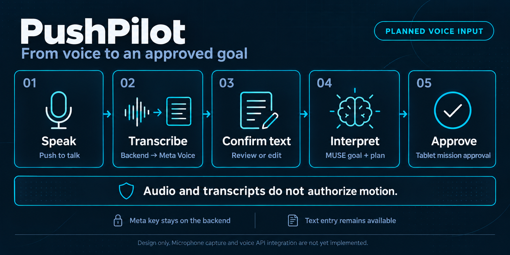

<sub>[PushPilot](../README.md) / Application / Frontend</sub>

# The operator workspace

**Make the plan, its evidence, and the next decision visible.**

[Mission](../docs/MISSION.md) · [Architecture](../docs/ARCHITECTURE.md) · [Voice input](../docs/VOICE_INPUT.md) · [Development](../docs/DEVELOPMENT.md)

> **Status: planned.** This directory currently contains documentation. No frontend framework, application bundle, development server, microphone capture, camera feed, or registered AR view is implemented.

## Experience direction

The primary experience is an English tablet workspace in dark navy and electric cyan. It follows **Observe → Plan → Approve → Act → Verify**. The operator should be able to explain why the system is waiting or proceeding by reading the same screen used to run the mission.

The AR-glasses companion is a future concept. Illustrations must say so. A tablet preview must not imply connected glasses, working voice input, spatial registration, or live hardware when those capabilities are unavailable.

| Workspace area | What it should communicate |
| :--- | :--- |
| Goal | Push-to-talk or typed input, an editable transcript, and the grounded symbolic interpretation. |
| Scene | Image source, capture time, visibility, and the item under review. |
| Plan | Abstract actions, the current action, and the next required check. |
| Review | Expected outcome beside observed outcome; the MUSE decision and uncertainty. |
| Mission status | Approval, action, mandatory stop, RED wait, GREEN check, reobservation, or fault. |
| Evidence and replay | The observations, reviews, and transitions behind the displayed state. |

## Voice input in the first demo

Voice goal entry is planned initial-demo scope. The first implementation uses a bounded push-to-talk recording and batch file transcription, with typed input available whenever goal entry is eligible.

[](../docs/assets/voice-input-flow.png)

The browser never calls Meta with the provider key. It submits the bounded recording to the backend voice adapter, which uses Meta Muse Voice Transcribe. Streaming and continuous listening are later extensions.

The original transcript must remain inspectable after edits. English UI controls may display actual Korean or English transcript data without translating it silently. `Use goal` submits the selected text through the same goal path as typed input; it is not mission approval.

| English label | Planned UI meaning |
| :--- | :--- |
| `Ready to record` | Capture is available; the microphone is not active. |
| `Requesting microphone access` | Browser permission is pending. |
| `Recording` | The browser confirms an active recording. |
| `Transcribing` | A submitted recording is awaiting a result. |
| `Review transcript` | The operator can inspect and edit returned text. |
| `Microphone access denied` | Capture is unavailable; typed input remains available. |
| `No speech detected` | No usable text was returned; retry or type the goal. |
| `Transcription failed` | The attempt failed; no goal was submitted. |
| `Cancelled` | The attempt was discarded; late results cannot replace newer input. |

Do not show `Recording`, live waveforms, a transcript, or connected speech status as real until supported by the corresponding runtime event. See the [voice input specification](../docs/VOICE_INPUT.md) for capture limits, cancellation and provenance.

## Behavior before visual polish

New typed or spoken goal entry is enabled only in non-executing preparation. During an active mission, including RED waiting and review, disable recording and goal changes. Check secure-context and microphone availability before requesting capture; the deployed tablet origin requires trusted HTTPS. Preserve typed fallback where goal entry is eligible. See [voice input](../docs/VOICE_INPUT.md).

Every configured intersection requires a verified stop, including when the visible signal is GREEN. RED, unknown, stale, or obscured signals keep the mission waiting. Accepted fresh GREEN and the required local and MUSE checks permit automatic entry; the operator should not need to press PLAY for each resumption.

The interface reflects supervisor state. A button cannot bypass observation freshness, approval, signal admission, or action-review gates. A UI **HOLD** means execution is inhibited; it is not a promise of immediate physical stopping.

Source labels belong beside the information they qualify. A real model response on a recorded image does not make the robot live. Show simulation, recorded input, live input, mock review, and actual provider review independently.

## Planned implementation areas

These are responsibilities to introduce with working code, not existing folders or selected libraries:

- **Workspace shell:** navigation, voice and typed goal entry, editable transcript confirmation, responsive tablet layout, accessible focus and status text.
- **Mission views:** supervisor state, action timeline, approval, traffic waiting, reobservation, and faults.
- **Scene presentation:** a placeholder initially; image review with source labels when available.
- **Evidence explorer:** request/review details, provenance, expected-versus-observed comparison, and replay.
- **API client:** versioned [contracts](../contracts/README.md) and explicit connection/capability state.

Use symbolic locations and abstract actions while the final map is on hold. Do not introduce an old board image as the active map, finalize routes or stop lines, or present an overlay as registered AR.

## First implementation acceptance checks

- The operator can distinguish a mock from an actual MUSE response without opening a log.
- A bounded recording yields an editable transcript through the backend; only `Use goal` submits it for interpretation.
- Permission denial, empty output, failure and cancellation preserve typed input; a stale result cannot overwrite newer input.
- Transcript confirmation and goal interpretation never imply mission approval.
- RED waiting and uncertain review visibly block progress.
- Accepted fresh GREEN changes the mission state without repeated manual approval.
- Restart and disconnection leave no button falsely implying an active crossing.
- Text and icons explain state without relying on color alone.
- Product copy, accessibility text, and errors are English.

Run repository checks from the repository root:

```sh
python tools/dev.py check
python tools/dev.py test
```

These currently validate the bootstrap and packaging tools. Frontend build and interaction checks will be documented when a runtime is selected.

---

[Backend boundary](../backend/README.md) · [Model interaction](../docs/META_INTELLIGENCE.md) · [Roadmap](../docs/ROADMAP.md)
